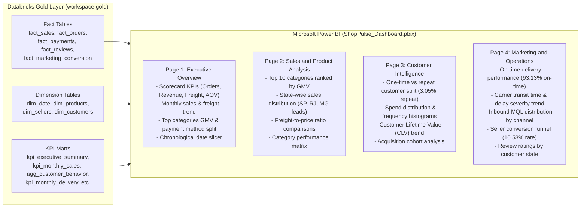

# ShopPulse: Technical Architecture & System Design Document

> **Architecture Style:** Medallion Lakehouse Architecture (Bronze $\rightarrow$ Silver $\rightarrow$ Gold)  
> **Processing Engine:** Apache Spark / PySpark on Databricks (Runtime 14.3+ LTS / Serverless Compute)  
> **Storage & Governance:** Delta Lake with Databricks Unity Catalog Volumes (`/Volumes/workspace/default/shoppulse_raw/`)  
> **Catalog & Schemas:** Catalog `workspace` | Bronze `default` | Silver `silver` | Gold `gold`  
> **Serving & Visualisation:** Databricks SQL Warehouse (Thrift Port 443) $\rightarrow$ Microsoft Power BI Desktop (4 Pages)  
> **Documentation Version:** 2.0 (Audited & Aligned with Verified Implementation — November 2026)

---

## 1. End-to-End System Architecture

```mermaid
flowchart TB
    subgraph DataSources["1. DATA SOURCES & INGESTION"]
        direction TB
        DS1["Olist Brazilian E-Commerce\n(9 Relational CSV Tables - Kaggle)"]
        DS2["Olist Marketing Funnel\n(2 Relational CSV Tables - Kaggle)"]
        DS3["Nager.Date REST API\n(Public Brazilian Holidays JSON)"]
        
        EXT["Python Extraction & Validation\n(src/extraction/api_extract_holidays.py\nsrc/extraction/validate_raw_files.py)"]
        DS1 --> EXT
        DS2 --> EXT
        DS3 --> EXT
    end

    subgraph StorageLayer["2. STORAGE ARCHITECTURE (Cloud Object Storage)"]
        LOCAL["Local Staging\nE:\\ShopPulse\\data\\raw\\"]
        VOL[("Databricks Unity Catalog Managed Volume\n/Volumes/workspace/default/shoppulse_raw/\n(Cloud Object Storage)")]
        EXT --> LOCAL
        LOCAL -->|Databricks UI / API Upload| VOL
    end

    subgraph DatabricksEngine["3. DATABRICKS LAKEHOUSE PROCESSING ENGINE (PySpark & Delta Lake)"]
        direction TB
        
        subgraph Notebook1["Notebook 1: notebooks/01_Raw_Bronze_Silver_Pipeline.ipynb"]
            direction TB
            subgraph Bronze["BRONZE LAYER (Schema: workspace.default)"]
                B_DESC["- Read raw CSV/JSON from Volume with multiLine handling\n- Store as append-only Delta tables with _ingested_at metadata\n- 100% row-count preservation across all 12 entities"]
                B_TBLS[("Bronze Delta Tables\n- bronze_orders (99,441)\n- bronze_order_items (112,650)\n- bronze_customers (99,441)\n- bronze_products (32,951)\n- bronze_sellers (3,095)\n- bronze_payments (103,886)\n- bronze_reviews (99,224)\n- bronze_geolocation (1,000,163)\n- bronze_category_translation (71)\n- bronze_marketing_qualified_leads (8,000)\n- bronze_closed_deals (842)\n- bronze_brazil_public_holidays (42)")]
            end

            subgraph Silver["SILVER LAYER (Schema: workspace.silver)"]
                S_DESC["- Timestamp & numeric type enforcement\n- Deduplication on primary keys\n- English category translation join\n- Holiday proximity tagging (3-day window)\n- Multi-line review comment normalization"]
                S_TBLS[("Silver Delta Tables\n- silver_orders\n- silver_customers\n- silver_order_items\n- silver_products\n- silver_sellers\n- silver_payments\n- silver_reviews\n- silver_geolocation\n- silver_marketing_qualified_leads\n- silver_closed_deals")]
            end
            Bronze --> Silver
        end

        subgraph Notebook2["Notebook 2: notebooks/gold/02_Gold_Layer_Analytics.ipynb"]
            direction TB
            subgraph Gold["GOLD LAYER (Schema: workspace.gold)"]
                G_DIMS[("Gold Dimensional Tables\n- dim_date\n- dim_products\n- dim_sellers\n- dim_customers\n- dim_geolocation")]
                G_FACTS[("Gold Fact Tables\n- fact_sales (98,666 orders with items)\n- fact_payments (103,886 records)\n- fact_reviews (99,224 records)\n- fact_marketing_conversion (8,000 MQLs, 842 deals)\n- fact_orders (99,441 total orders)")]
                G_KPIS[("Gold Analytical & KPI Marts\n- kpi_executive_summary\n- kpi_monthly_sales & kpi_monthly_payments\n- kpi_top_10_categories & kpi_sales_by_category\n- kpi_sales_by_state & kpi_sales_by_seller_state\n- kpi_monthly_delivery & kpi_reviews_by_state\n- kpi_monthly_reviews & kpi_monthly_marketing\n- agg_customer_behavior (95,420 unique customers)\n- kpi_customer_segments & kpi_monthly_customer_acquisition")]
            end
        end

        VOL --> Bronze
        Silver --> Gold
    end

    subgraph Serving["4. SERVING & BUSINESS INTELLIGENCE"]
        direction TB
        DWH["Databricks SQL Warehouse\n(Port 443 / Thrift Direct Connection)"]
        
        PBI["Microsoft Power BI Desktop (4 Pages)\n1. Executive Overview\n2. Sales and Product Analysis\n3. Customer Intelligence\n4. Marketing and Operations"]
        
        Gold --> DWH
        DWH --> PBI
    end
```

---

## 2. Storage Architecture Classification & Governance

All project datasets are governed within Databricks Unity Catalog to satisfy strict academic and enterprise cloud data engineering standards:

| Storage Type | Physical Location | Nature & Purpose | How ShopPulse Implements It |
| :--- | :--- | :--- | :--- |
| **1. Local Staging** | Local Developer Drive (`E:\ShopPulse\data\raw\`) | Ephemeral directory for Kaggle downloads and running API extraction scripts. | Staging only. Raw data is excluded from Git via `.gitignore`. |
| **2. Databricks-Managed Cloud Storage** | Cloud Object Storage (AWS S3 / Azure Blob / GCS) | Physical cloud object storage provisioned and managed by Databricks for workspace metadata and managed tables. | Forms the underlying cloud storage substrate. |
| **3. Unity Catalog Volumes** *(Implemented)* | Governed logical mount: `/Volumes/workspace/default/shoppulse_raw/` | **Modern Databricks standard (replaces deprecated DBFS root).** Stores non-tabular raw CSV and JSON files with POSIX path access. | **Primary Raw Storage:** All 15 source files uploaded and read directly by PySpark. |
| **4. Governed Schemas** | Managed Delta Lake tables inside Unity Catalog catalog `workspace` | ACID transactional table storage with automated schema enforcement, time-travel, and partition pruning. | - Bronze: `workspace.default` - Silver: `workspace.silver` - Gold: `workspace.gold` |

---

## 3. Verified Medallion Layer Specifications

### 3.1 Bronze Layer (Catalog: `workspace`, Schema: `default`)
- **Execution:** Implemented in `notebooks/01_Raw_Bronze_Silver_Pipeline.ipynb` (Cells 1–59).
- **Objective:** Ingest all raw CSV and JSON files from `/Volumes/workspace/default/shoppulse_raw/` into append-only Delta Lake tables with zero record loss.
- **Audit Columns Appended:**
  - `_ingested_at`: UTC timestamp of execution (`current_timestamp()`).
  - `_source_file`: File path of raw origin.
- **Specialized Parsing:** Customer reviews CSV parsed using `.option("multiLine", "true").option("quote", '"').option("escape", '"')` to resolve embedded newline characters.
- **Verified Bronze Tables:**
  - `workspace.default.bronze_orders` (99,441 records)
  - `workspace.default.bronze_order_items` (112,650 records)
  - `workspace.default.bronze_customers` (99,441 records)
  - `workspace.default.bronze_products` (32,951 records)
  - `workspace.default.bronze_sellers` (3,095 records)
  - `workspace.default.bronze_payments` (103,886 records)
  - `workspace.default.bronze_reviews` (99,224 records)
  - `workspace.default.bronze_geolocation` (1,000,163 records)
  - `workspace.default.bronze_category_translation` (71 records)
  - `workspace.default.bronze_marketing_qualified_leads` (8,000 records)
  - `workspace.default.bronze_closed_deals` (842 records)
  - `workspace.default.bronze_brazil_public_holidays` (42 records)

### 3.2 Silver Layer (Catalog: `workspace`, Schema: `silver`)
- **Execution:** Implemented in `notebooks/01_Raw_Bronze_Silver_Pipeline.ipynb` (Cells 60–192).
- **Objective:** Create cleaned, typed, deduplicated, and enriched tables.
- **Transformations:**
  1. Cast date strings to proper Spark `TimestampType`.
  2. Handle null delivery timestamps and validate delivery date sequences.
  3. Deduplicate on primary keys (e.g. `order_id`, `(order_id, order_item_id)`, `review_id`).
  4. Standardize text fields (trim, lowercase, proper case) and format zip code prefixes with `lpad(..., 5, '0')`.
  5. Join English product category translations to Portuguese categories (`silver_products`).
  6. Enrich orders with Brazilian public holiday proximity flags (3-day window before holidays).
  7. Audit geolocation duplicates and coordinate anomalies (`silver_geolocation_quality_audit`).
- **Verified Silver Tables:**
  - `workspace.silver.silver_orders`
  - `workspace.silver.silver_customers`
  - `workspace.silver.silver_order_items`
  - `workspace.silver.silver_products`
  - `workspace.silver.silver_sellers`
  - `workspace.silver.silver_payments` (plus `silver_payments_quality_audit`)
  - `workspace.silver.silver_reviews`
  - `workspace.silver.silver_geolocation` (plus `silver_geolocation_duplicate_audit`)
  - `workspace.silver.silver_marketing_qualified_leads`
  - `workspace.silver.silver_closed_deals`

### 3.3 Gold Layer (Catalog: `workspace`, Schema: `gold`)
- **Execution:** Implemented in `notebooks/gold/02_Gold_Layer_Analytics.ipynb` (Cells 2–115).
- **Objective:** Build star-schema dimensional tables, granular fact tables, and high-performance KPI aggregate marts for Power BI.
- **Dimensional Tables:**
  - `workspace.gold.dim_date`: Complete calendar dimension with year, month, quarter, day of week, and holiday flags.
  - `workspace.gold.dim_products`: Enriched product catalog with translated English categories and physical dimensions.
  - `workspace.gold.dim_sellers`: Merchant directory with location data.
  - `workspace.gold.dim_customers`: Unique customer directory mapped from `customer_unique_id`.
  - `workspace.gold.dim_geolocation`: Deduplicated geographic coordinates by Brazilian zip code prefix.
- **Fact Tables:**
  - `workspace.gold.fact_sales`: 98,666 orders with fulfilled items, total GMV R$ 13,591,643.70 + freight R$ 2,251,909.54 = R$ 15,843,553.24.
  - `workspace.gold.fact_payments`: 103,886 payment transactions totaling R$ 16,008,872.12 across credit card, boleto, voucher, and debit.
  - `workspace.gold.fact_reviews`: 99,224 customer reviews with satisfaction ratings (average 4.09 / 5.00) and response times.
  - `workspace.gold.fact_marketing_conversion`: 8,000 MQLs, 842 closed seller deals, and conversion time lag metrics.
  - `workspace.gold.fact_orders`: Master order fact table covering all 99,441 registered orders across all lifecycle statuses.
- **Analytical & KPI Tables:**
  - `workspace.gold.kpi_executive_summary`: One-row executive scorecard combining sales, payments, reviews, and marketing KPIs (AOV: R$ 160.58).
  - `workspace.gold.kpi_monthly_sales` & `kpi_monthly_payments`: Chronological monthly revenue, freight, installment, and payment type trends.
  - `workspace.gold.kpi_top_10_categories` & `kpi_sales_by_category`: Category GMV ranking, item volume, and freight share.
  - `workspace.gold.kpi_sales_by_state` & `kpi_sales_by_seller_state`: Geographic sales and fulfillment distributions.
  - `workspace.gold.kpi_monthly_delivery`: On-time delivery rate (93.13%), carrier transit lead times, and delay severity trends.
  - `workspace.gold.kpi_monthly_marketing`: Lead generation volume, channel attribution, and conversion rates over time.
  - `workspace.gold.kpi_monthly_reviews` & `kpi_reviews_by_state`: Satisfaction score distributions and regional rating averages.
  - `workspace.gold.agg_customer_behavior`: RFM customer profile mart (95,420 unique purchasers, 3.05% repeat customer rate).
  - `workspace.gold.kpi_customer_segments`: Segments customers into one-time vs repeat purchasers with spend profiles.
  - `workspace.gold.kpi_monthly_customer_acquisition`: Monthly new customer acquisition velocity.

---

## 4. Power BI Architecture & Dashboard Layout

The production report connects to the Databricks SQL Warehouse (Thrift port 443) to surface four dedicated reporting pages:

### Mashup Engine & Concurrency Optimization
To prevent OLE DB Mashup container memory exhaustion (`0x80040E4E`) during concurrent table evaluation over the Thrift connector:
- Configured `maxParallelism = 1` inside `dataAccessOptions`.
- Set `ConcurrentEvaluationCount = 1` and `MaxConcurrentEvaluations = 1` in Power BI queries settings.
- Rebuilt visual containers with validated `projections`, `query`, and `dataTransforms` structures.
