# ShopPulse: Technical Architecture & System Design Document

> **Architecture Style:** Medallion Lakehouse Architecture (Bronze $\rightarrow$ Silver $\rightarrow$ Gold)  
> **Processing Engine:** Apache Spark / PySpark on Databricks (Runtime 14.3+ LTS)  
> **Storage & Governance:** Delta Lake with Databricks Unity Catalog Volumes (Cloud Object Storage)  
> **Serving & Visualisation:** Databricks SQL Warehouse / Gold Parquet Export $\rightarrow$ Microsoft Power BI Desktop  
> **Documentation Version:** 1.1 (Audited & Updated for November 2026 Standards)

---

## 1. End-to-End System Architecture

```mermaid
flowchart TB
    subgraph DataSources["1. DATA SOURCES & INGESTION"]
        direction TB
        DS1["Olist Brazilian E-Commerce\n(9 CSV Tables - Kaggle)"]
        DS2["Olist Marketing Funnel\n(2 CSV Tables - Kaggle)"]
        DS3["Nager.Date REST API\n(Public Brazilian Holidays JSON)"]
        
        EXT["Python Extraction & Validation\n(src/extraction/api_extract_holidays.py)"]
        DS1 --> EXT
        DS2 --> EXT
        DS3 --> EXT
    end

    subgraph StorageLayer["2. STORAGE ARCHITECTURE (Cloud Object Storage)"]
        LOCAL["Local Windows PC\nE:\\ShopPulse\\data\\raw\\"]
        VOL[("Databricks Unity Catalog Volume\n/Volumes/main/shoppulse_bronze/raw_data/\n(Managed Cloud Object Storage)")]
        EXT --> LOCAL
        LOCAL -->|Databricks UI / API Upload| VOL
    end

    subgraph DatabricksEngine["3. DATABRICKS LAKEHOUSE PROCESSING ENGINE (PySpark)"]
        direction TB
        
        subgraph Bronze["BRONZE LAYER (Raw Delta Ingestion)"]
            B_DESC["- Read raw CSV/JSON from Unity Catalog Volume\n- Store as append-only Delta tables\n- Ingestion metadata (_ingested_at, _source_file)\n- Schema preservation without record loss"]
            B_TBLS[("Bronze Delta Tables\n- bronze_orders\n- bronze_order_items\n- bronze_customers\n- bronze_products\n- bronze_sellers\n- bronze_payments\n- bronze_reviews\n- bronze_geolocation\n- bronze_marketing_leads\n- bronze_closed_deals\n- bronze_public_holidays")]
        end

        subgraph Silver["SILVER LAYER (Cleansed & Enriched Delta)"]
            S_DESC["- Type enforcement (Timestamps, Floats, Integers)\n- Deduplication on primary keys\n- Null handling & anomaly treatment\n- Verified relational joins & English category mapping\n- Public holiday proximity tagging"]
            S_TBLS[("Silver Delta Tables\n- silver_orders_enriched\n- silver_order_items_detailed\n- silver_customer_profiles\n- silver_seller_funnel_attributed\n- silver_reviews_analyzed\n- silver_public_holidays")]
        end

        subgraph Gold["GOLD LAYER (Curated Business Marts)"]
            G_DESC["- Star-schema dimensional marts\n- High-level business KPIs & aggregations\n- Optimised for fast BI reporting"]
            G_TBLS[("Gold Delta Tables\n- gold_daily_sales_performance\n- gold_delivery_logistics_intelligence\n- gold_customer_behaviour_rfm\n- gold_product_category_intelligence\n- gold_seller_marketing_funnel\n- gold_holiday_impact_analysis")]
        end

        VOL --> Bronze
        Bronze --> Silver
        Silver --> Gold
    end

    subgraph Serving["4. SERVING & BUSINESS INTELLIGENCE"]
        direction TB
        CONN{"Connectivity Option"}
        Gold --> CONN
        
        CONN -->|Option A: Cloud Trial / Full Workspace| DWH["Databricks SQL Warehouse\n(DirectQuery / Import Connector)"]
        CONN -->|Option B: Free / Community Workspace| EXP[("Gold Parquet / CSV Exports\n(data/gold_exports/)")]
        
        DWH --> PBI["Microsoft Power BI Desktop\n- Executive Overview\n- Sales Intelligence\n- Delivery Performance\n- Customer Retention\n- Marketing Funnel"]
        EXP --> PBI
    end
```



---

## 2. Storage Architecture Classification & Professor Requirements

To satisfy our professor's strict requirement: *"Raw data must be stored in cloud/object storage. Do not pretend that a local folder alone satisfies the cloud/object-storage requirement. Prefer Unity Catalog Volumes if supported. Do not silently fall back to deprecated DBFS root."*

We strictly distinguish between the four storage tiers:

| Storage Type | Physical Location | Nature & Purpose | How ShopPulse Uses It |
| :--- | :--- | :--- | :--- |
| **1. Local Storage** | Developer Windows PC (`E:\ShopPulse\data\raw\`) | Ephemeral staging for downloading Kaggle datasets and testing Python extraction scripts. | Staging only. Raw files are not processed directly from here by Spark. |
| **2. Databricks-Managed Storage** | Cloud Object Storage (AWS S3, Azure Blob/ADLS, or GCS) | The cloud storage bucket provisioned and managed by Databricks behind the scenes for workspace metadata and managed tables. | Forms the underlying cloud physical layer. |
| **3. Unity Catalog Volumes** *(Selected)* | Governed logical mount inside cloud object storage (`/Volumes/<catalog>/<schema>/<volume_name>/`) | **Modern Databricks standard (replaces deprecated DBFS root).** Manages non-tabular raw files (CSVs, JSON) with strict governance, access control, and native Spark path resolution. | **Primary Raw Storage:** Raw files uploaded here: `/Volumes/main/shoppulse_bronze/raw_data/`. |
| **4. External Cloud Object Storage** | Direct customer-owned AWS S3 / Azure ADLS Gen2 / GCS bucket | External storage requiring manual cloud IAM credentials and storage credentials setup. | Not required for student demonstration; Unity Catalog Managed Volumes already reside in cloud object storage! |

### Why Unity Catalog Volumes Satisfies the College Requirement:
1. When you create a Unity Catalog Volume (e.g., in catalog `main`, schema `shoppulse_bronze`), Databricks stores those files directly inside cloud object storage.
2. It gives you a clean POSIX path (`/Volumes/main/shoppulse_bronze/raw_data/olist_orders_dataset.csv`) that PySpark can read natively with `spark.read.csv()`.
3. It completely avoids the deprecated `dbfs:/FileStore/` root while remaining 100% cloud-hosted.

---

## 3. Databricks Technical Capabilities Audit (2026 Standards)

| Capability / Feature | Databricks Free / Community Edition | Databricks Cloud Trial (AWS / Azure / GCP) | Impact on ShopPulse & Strategy |
| :--- | :--- | :--- | :--- |
| **Unity Catalog** | Available (Default workspace/personal catalog `main` or `workspace`) | Full Enterprise Unity Catalog | Supported. We use catalog `main` and schema `shoppulse_bronze`. |
| **Unity Catalog Volumes** | Supported (Managed Volumes via Catalog Explorer) | Supported (Managed & External Volumes) | Supported. We create volume `raw_data` inside `shoppulse_bronze`. |
| **Delta Lake Tables (PySpark)** | Fully Supported (`format("delta")`) | Fully Supported | Supported. Bronze, Silver, and Gold tables are created as native Delta Lake tables with full ACID compliance. |
| **Compute Type** | All-Purpose Cluster (1 node, 15GB RAM, 2 vCPUs, auto-terminates after 2 hours idle) | Serverless Notebook Compute or Multi-Node All-Purpose Clusters | In Community Edition, we start the All-Purpose Cluster manually before running notebooks. In Cloud Trial, serverless compute starts instantly. |
| **Outbound Internet Access** | Open (Clusters can call public REST endpoints) | Open (or VPC-governed) | Verified. Python `requests` or `urllib` can fetch data from Nager.Date API directly inside Databricks if desired. |
| **Databricks SQL Warehouses** | Disabled / Not Available | Available (Serverless or Classic SQL Warehouses) | Crucial for BI: See Section 4 for dual-mode connection. |
| **Power BI Direct Connector** | Unsupported (Because SQL Warehouses are disabled) | Fully Supported via native Databricks connector | Dual strategy ensures zero failure risk. |

---

## 4. Power BI Connectivity Strategy

To ensure zero risk during the viva defense:

### Option A: Direct Cloud Connection (If using Databricks Cloud Trial)
* **Compute:** Databricks Serverless or Classic SQL Warehouse.
* **Mechanism:** Power BI Desktop $\rightarrow$ Get Data $\rightarrow$ Databricks $\rightarrow$ Enter Server Hostname & HTTP Path $\rightarrow$ Authenticate via Personal Access Token (PAT).
* **Mode:** DirectQuery or Import.

### Option B: Curated Gold Export Import (If using Databricks Free / Community Edition)
* **Limitation:** Free Community Edition does not provide SQL Warehouses. Attempting to connect Power BI Desktop to a Community Edition host fails because no JDBC/ODBC SQL endpoint exists.
* **The Engineering Solution:**  
  Notebook 03 (`03_gold_business_aggregates.py`) creates the Gold Delta tables inside Databricks, proving 100% of the Spark/Delta pipeline. It then exports the final aggregate tables to `data/gold_exports/` in Parquet and CSV formats:
  ```python
  # PySpark export cell in Databricks Notebook 03:
  gold_daily_sales.toPandas().to_csv("/Volumes/main/shoppulse_bronze/raw_data/gold_exports/gold_daily_sales.csv", index=False)
  ```
* These files are downloaded to `data/gold_exports/` and imported into Power BI Desktop using the native Folder / CSV connector.
* **Result:** The Power BI dashboard, star-schema data model, and DAX measures are 100% genuine and fully functional.

---

## 5. Medallion Layer Specifications

### 5.1 Bronze Layer (Raw Storage to Delta)
* **Objective:** Ingest raw CSV and JSON files from Unity Catalog Volume into native Delta format with zero record loss.
* **Metadata Appended:**
  * `_ingested_at`: UTC timestamp of pipeline execution.
  * `_source_file`: File name of raw origin.
* **Storage Format:** Delta Lake (`format("delta")`).

### 5.2 Silver Layer (Cleansing, Typing & Enrichment)
* **Objective:** Create cleaned, typed, and joined enterprise relational tables.
* **Transformations:**
  1. Cast string timestamps to Spark `TimestampType`.
  2. Deduplicate orders on `order_id` and order items on `(order_id, order_item_id)`.
  3. Coalesce null review comments to `"No review text provided"`.
  4. Join English product category translations to Brazilian category names.
  5. Join Olist marketing funnel closed deals with seller records on `seller_id`.
  6. Flag holiday purchases against Brazilian national holidays.

### 5.3 Gold Layer (Business KPIs & Analytical Marts)
* **Objective:** Aggregated star-schema dimensional marts designed for the Power BI dashboard:
  1. `gold_daily_sales_performance`: Daily gross revenue, order volume, Average Order Value (AOV).
  2. `gold_delivery_logistics_intelligence`: Delay rates, state-wise delivery transit times, carrier SLA adherence.
  3. `gold_customer_behaviour_rfm`: Customer purchase frequency, recency, lifetime spend.
  4. `gold_product_category_intelligence`: Category sales contribution, customer ratings, cancellation rates.
  5. `gold_seller_marketing_funnel`: MQL to closed deal conversion rate, seller onboarding turnaround.
  6. `gold_holiday_impact_analysis`: Holiday uplift versus non-holiday baseline sales.
