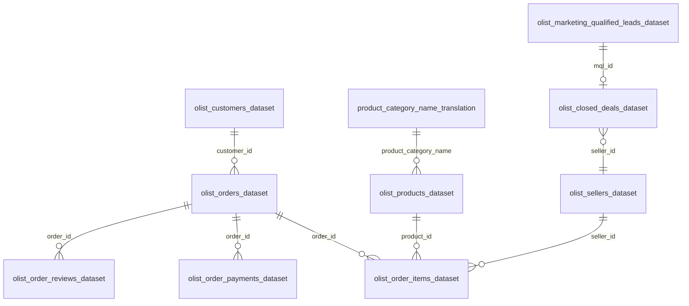

# ShopPulse: Verified Data Source Register & Data Dictionary

> **Compliance Notice:**  
> The multiple CSV files originating from Olist represent normalized relational tables from a single core e-commerce database, not independent data sources. They are classified below according to their true provenance.

---

## 1. Source Summary Overview

| Source ID | Source Name | Nature / Format | Provider / Platform | License | Verified Date Range |
| :--- | :--- | :--- | :--- | :--- | :--- |
| **SRC-01** | Olist Brazilian E-Commerce Dataset | 9 Normalized Relational CSV Tables | Olist / Kaggle | CC BY-NC-SA 4.0 | Sep 2016 – Oct 2018 |
| **SRC-02** | Olist Marketing Funnel Dataset | 2 Relational CSV Tables | Olist / Kaggle | CC BY-NC-SA 4.0 | Jun 2017 – Jun 2018 |
| **SRC-03** | Nager.Date Public Holidays API | RESTful JSON API | Nager.Date (Open Source) | MIT / Public Domain | 2016 – 2018 (Relevant Years) |

---

## 2. Detailed Source Documentation

### Source 1: Brazilian E-Commerce Public Dataset by Olist (SRC-01)
- **Source URL:** [https://www.kaggle.com/datasets/olistbr/brazilian-ecommerce](https://www.kaggle.com/datasets/olistbr/brazilian-ecommerce)
- **Retrieval Method:** Direct Download / Kaggle API
- **Date Accessed:** 12 November 2026
- **Applicable License:** Creative Commons Attribution-NonCommercial-ShareAlike 4.0 International (CC BY-NC-SA 4.0)
- **Description:** Real anonymised commercial transactional database of orders made at Olist Store in Brazil from 2016 to 2018.

#### Table Inventory & Schema Details:

1. **`olist_orders_dataset.csv`** (Primary transactional grain: 1 row = 1 order)
   - `order_id` (String, Primary Key): Unique alphanumeric order identifier.
   - `customer_id` (String, Foreign Key $\rightarrow$ `olist_customers_dataset.csv`): Order-specific customer token.
   - `order_status` (String): Order lifecycle state (`delivered`, `shipped`, `canceled`, `invoiced`, `processing`, `created`, `approved`, `unavailable`).
   - `order_purchase_timestamp` (Timestamp): Timestamp when purchase was made.
   - `order_approved_at` (Timestamp): Timestamp when payment was approved.
   - `order_delivered_carrier_date` (Timestamp): Timestamp when order was handed to logistics partner.
   - `order_delivered_customer_date` (Timestamp): Actual delivery date to customer.
   - `order_estimated_delivery_date` (Timestamp): Estimated delivery date promised at checkout.

2. **`olist_order_items_dataset.csv`** (Line item grain: 1 row = 1 item in an order)
   - `order_id` (String, Composite PK / FK): References `olist_orders_dataset.csv`.
   - `order_item_id` (Integer, Composite PK): Sequential item index within the order (1, 2, 3...).
   - `product_id` (String, Foreign Key $\rightarrow$ `olist_products_dataset.csv`): Product identifier.
   - `seller_id` (String, Foreign Key $\rightarrow$ `olist_sellers_dataset.csv`): Merchant fulfilling this item.
   - `shipping_limit_date` (Timestamp): Seller fulfillment deadline.
   - `price` (Float): Item sale price in Brazilian Real (BRL).
   - `freight_value` (Float): Freight/shipping fee charged for this item in BRL.

3. **`olist_customers_dataset.csv`** (Customer location grain)
   - `customer_id` (String, Primary Key): Per-order customer identifier (used to join with orders).
   - `customer_unique_id` (String): Unique real customer identifier (enables tracking repeat purchases across orders).
   - `customer_zip_code_prefix` (Integer): First 5 digits of customer zip code.
   - `customer_city` (String): City name (e.g., `sao paulo`, `rio de janeiro`).
   - `customer_state` (String): 2-letter Brazilian state code (e.g., `SP`, `RJ`, `MG`).

4. **`olist_products_dataset.csv`** (Product catalog)
   - `product_id` (String, Primary Key): Unique product identifier.
   - `product_category_name` (String): Category name in Portuguese (e.g., `cama_mesa_banho`).
   - `product_name_length` (Integer): Character length of product title.
   - `product_description_length` (Integer): Character length of description.
   - `product_photos_qty` (Integer): Number of product listing photos.
   - `product_weight_g`, `product_length_cm`, `product_height_cm`, `product_width_cm` (Float): Physical package dimensions.

5. **`olist_sellers_dataset.csv`** (Merchant directory)
   - `seller_id` (String, Primary Key): Unique merchant identifier.
   - `seller_zip_code_prefix` (Integer): 5-digit zip code prefix of seller location.
   - `seller_city` (String): City name of merchant.
   - `seller_state` (String): 2-letter Brazilian state code of merchant.

6. **`olist_order_payments_dataset.csv`** (Payment ledger: 1 order may have multiple payment rows)
   - `order_id` (String, Foreign Key $\rightarrow$ `olist_orders_dataset.csv`): Associated order.
   - `payment_sequential` (Integer): Sequential payment installment order.
   - `payment_type` (String): Payment method (`credit_card`, `boleto`, `voucher`, `debit_card`, `not_defined`).
   - `payment_installments` (Integer): Selected number of installments.
   - `payment_value` (Float): Monetary amount paid in BRL.

7. **`olist_order_reviews_dataset.csv`** (Satisfaction feedback)
   - `review_id` (String): Unique review identifier.
   - `order_id` (String, Foreign Key $\rightarrow$ `olist_orders_dataset.csv`): Associated order.
   - `review_score` (Integer): Rating from 1 (lowest) to 5 (highest).
   - `review_comment_title` (String): Feedback title (often null).
   - `review_comment_message` (String): Review text comment in Portuguese (often null).
   - `review_creation_date` (Timestamp): Date review survey was generated.
   - `review_answer_timestamp` (Timestamp): Timestamp when customer submitted feedback.

8. **`olist_geolocation_dataset.csv`** (Geographical coordinates)
   - `geolocation_zip_code_prefix` (Integer): 5-digit zip code.
   - `geolocation_lat` (Float): Latitude.
   - `geolocation_lng` (Float): Longitude.
   - `geolocation_city` (String): City name.
   - `geolocation_state` (String): State code.

9. **`product_category_name_translation.csv`** (Translation dictionary)
   - `product_category_name` (String): Portuguese category name.
   - `product_category_name_english` (String): English translation (e.g., `bed_bath_table`).

---

### Source 2: Olist Marketing Funnel Dataset (SRC-02)
- **Source URL:** [https://www.kaggle.com/datasets/olistbr/marketing-funnel-olist](https://www.kaggle.com/datasets/olistbr/marketing-funnel-olist)
- **Retrieval Method:** Direct Download / Kaggle API
- **Date Accessed:** 12 November 2026
- **Applicable License:** CC BY-NC-SA 4.0
- **Description:** Data collected from Olist inbound marketing funnels between June 2017 and June 2018.

#### Table Inventory & Schema Details:

1. **`olist_marketing_qualified_leads_dataset.csv`** (Top of funnel)
   - `mql_id` (String, Primary Key): Marketing qualified lead identifier.
   - `first_contact_date` (Date): Date the lead requested contact on an Olist landing page.
   - `landing_page_id` (String): UUID of the landing page where form was submitted.
   - `origin` (String): Acquisition channel (e.g., `organic_search`, `paid_search`, `social`, `direct_traffic`, `referral`).

2. **`olist_closed_deals_dataset.csv`** (Bottom of funnel / conversions)
   - `mql_id` (String, Foreign Key $\rightarrow$ `mql_id` in MQL table): Unique lead identifier.
   - `seller_id` (String, Foreign Key $\rightarrow$ `seller_id` in `olist_sellers_dataset.csv`): Assigned merchant ID after contract signing.
   - `sdr_id` (String): Sales Development Representative identifier.
   - `sr_id` (String): Sales Representative identifier.
   - `won_date` (Timestamp): Date deal was closed.
   - `business_segment` (String): Seller industry segment (e.g., `home_decor`, `pet`, `health_beauty`).
   - `lead_type` (String): `online_retailer`, `manufacturer`, `reseller`, etc.
   - `lead_behaviour_profile` (String): Interaction profile (`cat`, `wolf`, `shark`, `eagle`).
   - `has_company` (Boolean): Registered company status.
   - `has_gtin` (Boolean): Barcode availability.
   - `average_stock` (String): Declared stock volume range.
   - `business_type` (String): Category of business model.
   - `declared_product_catalog_size` (Float): Estimated catalog size.
   - `declared_monthly_revenue` (Float): Declared revenue at onboarding.

---

### Source 3: Nager.Date Public Holidays REST API (SRC-03)
- **Source URL:** [https://date.nager.at/api/v3/PublicHolidays/{Year}/BR](https://date.nager.at/api/v3/PublicHolidays/{Year}/BR)
- **Retrieval Method:** Automated Python HTTP GET requests
- **Date Accessed:** 12 November 2026
- **Applicable License:** Public Domain / Open Source
- **Authentication:** None required (completely open API)
- **Target Years:** 2016, 2017, 2018 (spanning the active Olist purchase dates)

#### Sample JSON Response Record:
```json
{
  "date": "2017-01-01",
  "localName": "Confraternização Universal",
  "name": "New Year's Day",
  "countryCode": "BR",
  "fixed": true,
  "global": true,
  "counties": null,
  "launchYear": null,
  "types": [
    "Public"
  ]
}
```

---

## 3. Verified Join Keys and Inter-Dataset Relationships



### Critical Data Relationship Findings (Important for Defense!):

1. **Orders to Customers:**
   - Joining `orders` with `customers` on `customer_id` gives 1:1 relationship per order.
   - To calculate customer retention, group by `customer_unique_id`. An individual person has one `customer_unique_id` but may have multiple `customer_id` values across different orders.

2. **Orders to Items:**
   - 1 order may contain multiple items (`order_item_id = 1, 2, 3...`).
   - Different items in the *same* order can be fulfilled by *different* sellers!

3. **Marketing Funnel to Main Marketplace:**
   - Total Marketing Qualified Leads (MQLs): **8,000**.
   - Total Closed Deals won: **842** (each with a unique `mql_id` and unique `seller_id`, giving a lead conversion rate of 10.53%).
   - **Seller Overlap Verification (Audited in Phase 1A):**
     - Out of the 842 closed deals, exactly **380 sellers** match the registered merchant directory (`olist_sellers_dataset.csv`) and also have active sales records in `olist_order_items_dataset.csv`.
     - The remaining **462 closed-deal sellers** do not appear in the transaction tables because their contracts were finalized near the end of the observation window (June 2017 – June 2018) or prior to completing catalog onboarding and first order fulfillment.
     - Out of 3,095 total marketplace sellers, 2,715 joined through channels prior to the marketing funnel tracking period or via direct outbound acquisition.
   - **Crucial Rule:** We do NOT invent synthetic sellers or force artificial joins. In Silver/Gold ETL, marketing conversion is modeled on the authentic cohort of 842 closed deals, and sales attribution is linked specifically to the 380 active selling merchants.

4. **Holiday Impact Relationship:**
   - The order table purchase date `CAST(order_purchase_timestamp AS DATE)` is joined or flagged against the `date` field in `holidays_brazil_2016_2018.json` (also checking a window of 3 days before major holidays like Black Friday, Carnival, and Christmas).

