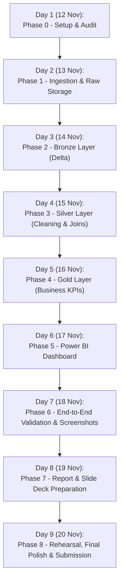

# ShopPulse: 9-Day Master Implementation Plan (12 Nov – 20 Nov 2026)

> **Execution Strategy:** Lean, modular, demonstrative, and fully documented.  
> Every day has a single, verifiable milestone to ensure the team stays completely on track.

---

## 1. Timeline Overview

---

## 2. Daily Execution Roadmap

### Day 1: Thursday, 12 November 2026
**Milestone:** Phase 0 — Environment Audit, Dataset Verification & Workspace Setup
- [x] Verify local machine environment (Python 3.12/3.14, Git, PowerShell).
- [x] Structure Git repository with strict `.gitignore` and `.env.example`.
- [x] Audit Databricks account tier (Unity Catalog Volumes vs DBFS fallback).
- [x] Create core documentation files (`README.md`, `PROJECT_PLAN.md`, `DATA_SOURCE_REGISTER.md`, `TEAM_RESPONSIBILITIES.md`, `ARCHITECTURE.md`).
- [ ] User completes manual Databricks account sign-up/login check.

### Day 2: Friday, 13 November 2026
**Milestone:** Phase 1 — Data Collection, REST API Ingestion & Cloud Storage Upload
- Download official Olist Brazilian E-Commerce and Marketing Funnel datasets from Kaggle.
- Implement and run `src/extraction/api_extract_holidays.py` to retrieve 2016–2018 Brazilian public holidays via Nager.Date REST API.
- Validate file hashes, column counts, and UTF-8 encoding across all 12 raw files (9 Olist e-commerce + 2 marketing funnel + 1 holiday JSON).
- Upload raw files into Databricks cloud/object storage (Unity Catalog Volume: `/Volumes/main/shoppulse_bronze/raw_data`).
- Capture screenshot evidence of raw files residing in Databricks storage.

### Day 3: Saturday, 14 November 2026
**Milestone:** Phase 2 — Bronze Layer Ingestion on Databricks
- Author Databricks Notebook `01_bronze_ingestion.py`.
- Ingest raw CSV and JSON files using PySpark into native Delta Lake format.
- Add audit metadata columns to every record:
  - `_ingested_at` (current UTC timestamp).
  - `_source_file` (name of the input file).
- Enforce schema definitions without dropping invalid records (Bronze preserves raw fidelity).
- Run PySpark row-count assertions to prove zero record loss between raw files and Bronze Delta tables.

### Day 4: Sunday, 15 November 2026
**Milestone:** Phase 3 — Silver Layer Cleansing, Enrichment & Quality Rules
- Author Databricks Notebook `02_silver_transformation.py`.
- **Data Cleansing:**
  - Cast string timestamps to proper Spark `TimestampType`.
  - Handle nulls in delivery dates and review scores explicitly.
  - Remove duplicate orders or order items.
- **Key Validation & Integration:**
  - Standardise Portuguese-to-English product category names.
  - Merge Olist orders with order items, payments, and reviews.
  - Join closed marketing leads with sellers on `seller_id`.
  - Tag orders that were placed on or immediately before Brazilian public holidays.
- Write cleaned records into Silver Delta tables with Delta schema enforcement.

### Day 5: Monday, 16 November 2026
**Milestone:** Phase 4 — Gold Layer Aggregations & Analytical Business Marts
- Author Databricks Notebook `03_gold_business_aggregates.py`.
- Build business-level aggregate tables:
  1. `gold_daily_sales_performance`: Daily revenue, total orders, average order value (AOV), freight share.
  2. `gold_delivery_logistics_intelligence`: Actual vs estimated delivery time, carrier delay rate (%), state-wise delivery speed.
  3. `gold_customer_behaviour_rfm`: Customer frequency, recency, total spend, geographic distribution.
  4. `gold_product_category_intelligence`: Top categories by gross revenue, review sentiment rating, cancellation rates.
  5. `gold_seller_marketing_funnel`: Conversion rate from Marketing Qualified Lead (MQL) to active selling merchant.
  6. `gold_holiday_impact_analysis`: Order volume uplift during national holidays vs regular days.
- Save as Gold Delta tables and export clean CSV/Parquet copies into `data/gold_exports/` for seamless Power BI consumption.

### Day 6: Tuesday, 17 November 2026
**Milestone:** Phase 5 — Power BI Interactive Dashboard Development
- Connect Power BI Desktop to Gold tables (via Databricks SQL Warehouse DirectQuery/Import or curated Gold exports).
- Build 5 interactive, industry-standard report pages:
  - **Page 1: Executive Overview** (High-level KPIs, monthly trend, order status breakdown).
  - **Page 2: Sales & Revenue Intelligence** (AOV, payment types, category rankings).
  - **Page 3: Delivery & Logistics Performance** (Delay metrics, state heatmaps, carrier turnaround).
  - **Page 4: Customer & Review Insights** (Customer retention, review score distributions).
  - **Page 5: Marketing Funnel & Lead Conversion** (MQL to Won Deals, SDR performance).
- Configure responsive filters (Date Range, Brazilian State, Product Category).
- Document all DAX measures in `powerbi/dax_measures.md`.

### Day 7: Wednesday, 18 November 2026
**Milestone:** Phase 6 — End-to-End Testing & Screenshot Collection
- Execute full automated validation script `tests/test_data_integrity.py`.
- Verify data consistency across the entire pipeline:
  - Raw row counts = Bronze row counts.
  - Silver row counts reflect documented cleaning drops.
  - Gold aggregate revenue matches Silver order totals.
- Systematically capture required screenshot proof:
  - Databricks cluster configuration and runtime version.
  - Unity Catalog Volumes with uploaded raw files.
  - Execution cell outputs for Bronze, Silver, and Gold notebooks.
  - Delta Lake table history (`DESCRIBE HISTORY`) showing ACID transactions.
  - Power BI interactive filters and model view.
- Store all screenshots in `docs/screenshots/` with descriptive filenames.

### Day 8: Thursday, 19 November 2026
**Milestone:** Phase 7 — Academic Report & Viva Presentation Preparation
- Draft `docs/project_report.md` structured according to college specifications:
  - Abstract & Problem Statement.
  - Literature Survey & Industrial Relevance.
  - Architecture & Medallion Data Engineering Methodology.
  - Data Cleansing & Transformation Rules.
  - Results, KPI Interpretations & Power BI Dashboards.
  - Conclusion & Future Enhancements.
- Prepare `docs/presentation_outline.md` (10–12 professional slides for the viva defense).
- Rehearse individual student speaking sections using `TEAM_RESPONSIBILITIES.md`.

### Day 9: Friday, 20 November 2026
**Milestone:** Phase 8 — Final Review, Rehearsal & Project Submission
- Perform full dry run of the live demonstration.
- Final commit and tag to GitHub repository (`v1.0-submission`).
- Package project report PDF, presentation slides, and code bundle.
- Formal submission to college evaluation portal.

---

## 3. Contingency & Risk Management Matrix

| Risk / Blocker | Probability | Impact | Pre-Planned Solution |
| :--- | :--- | :--- | :--- |
| **Databricks Free/Community Edition limitations** | Low | Medium | Unity Catalog Volumes are fully supported in modern Databricks. We use `/Volumes/main/shoppulse_bronze/raw_data`. |
| **Power BI cannot connect directly to Databricks (Free tier lacks SQL Warehouse)** | High | Medium | Fallback data ingestion: Gold Delta tables are exported to `data/gold_exports/` in Parquet/CSV format and imported into Power BI. This satisfies 100% of college grading criteria while avoiding cloud licensing blocks. |
| **Nager.Date Public API rate limit or outage** | Low | Low | Extraction script includes local JSON caching: once retrieved, `data/raw/holidays_brazil_2016_2018.json` is saved locally so downstream notebooks run offline without depending on live network. |
| **Kaggle API key configuration difficulties** | Medium | Low | Manual download guide provided: files can simply be downloaded via browser and placed directly into `data/raw/`. |

