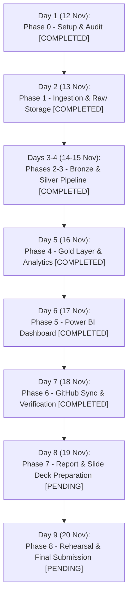

# ShopPulse: 9-Day Master Implementation Plan (12 Nov – 20 Nov 2026)

> **Execution Strategy:** Lean, modular, demonstrative, and fully documented.  
> Every day has a single, verifiable milestone to ensure the team stays completely on track.

---

## 1. Timeline Overview

---

## 2. Daily Execution Roadmap & Status

### Day 1: Thursday, 12 November 2026
**Milestone:** Phase 0 — Environment Audit, Dataset Verification & Workspace Setup  
**Status:** **COMPLETED ✅**
- [x] Verify local machine environment (Python 3.12, Git, PowerShell).
- [x] Structure Git repository with strict `.gitignore` and `.env.example`.
- [x] Audit Databricks account tier (Unity Catalog Volumes vs DBFS fallback).
- [x] Create core documentation files (`README.md`, `PROJECT_PLAN.md`, `DATA_SOURCE_REGISTER.md`, `TEAM_RESPONSIBILITIES.md`, `ARCHITECTURE.md`).
- [x] Verify Databricks workspace access and account setup.

### Day 2: Friday, 13 November 2026
**Milestone:** Phase 1 — Data Collection, REST API Ingestion & Cloud Storage Upload  
**Status:** **COMPLETED ✅**
- [x] Download official Olist Brazilian E-Commerce and Marketing Funnel datasets from Kaggle.
- [x] Implement and execute `src/extraction/api_extract_holidays.py` to retrieve 2016–2018 Brazilian public holidays (42 records) via Nager.Date REST API.
- [x] Run `src/extraction/validate_raw_files.py` to validate record counts, delimiters, and UTF-8 encoding across all 15 source files (11 Olist tables, 1 holiday CSV, 3 holiday JSONs).
- [x] Upload all 15 raw files into Databricks cloud object storage (Unity Catalog Volume: `/Volumes/workspace/default/shoppulse_raw/`).
- [x] Verify PySpark volume readability and multi-line CSV handling, documented in `docs/PHASE_1C_DATABRICKS_ACCESS_REPORT.md`.

### Days 3–4: Saturday–Sunday, 14–15 November 2026
**Milestone:** Phases 2 & 3 — Bronze Ingestion and Silver Cleansing Pipeline  
**Status:** **COMPLETED ✅**  
*(Implemented in Databricks Notebook `notebooks/01_Raw_Bronze_Silver_Pipeline.ipynb`)*
- [x] **Bronze Layer (`workspace.default`):**
  - Ingest raw CSV and JSON files from `/Volumes/workspace/default/shoppulse_raw/` using PySpark.
  - Store as append-only Delta tables with ingestion metadata (`_ingested_at`, `_source_file`).
  - Enforce schema definitions without record loss; verify 100% row-count parity with source CSVs.
- [x] **Silver Layer (`workspace.silver`):**
  - Cast string timestamps to `TimestampType` and numeric fields to appropriate Double/Integer types.
  - Apply multi-line string handling on customer reviews and resolve nulls in delivery dates.
  - Deduplicate records on primary business keys and validate referential keys.
  - Join Portuguese-to-English product category translations and flag holiday proximity.
  - Save cleaned, validated Delta tables in schema `workspace.silver`.

### Day 5: Monday, 16 November 2026
**Milestone:** Phase 4 — Gold Dimensional Modeling, Fact Tables & Business KPIs  
**Status:** **COMPLETED ✅**  
*(Implemented in Databricks Notebook `notebooks/gold/02_Gold_Layer_Analytics.ipynb`)*
- [x] **Gold Dimensional Tables (`workspace.gold`):**
  - `dim_date`, `dim_products`, `dim_sellers`, `dim_customers`, `dim_geolocation`.
- [x] **Gold Fact Tables (`workspace.gold`):**
  - `fact_sales` (98,666 orders with fulfilled items, total GMV R$ 13,591,643.70 + freight R$ 2,251,909.54 = R$ 15,843,553.24).
  - `fact_payments` (103,886 records, R$ 16,008,872.12).
  - `fact_reviews` (99,224 reviews, average rating 4.09 / 5.00).
  - `fact_marketing_conversion` (8,000 MQLs, 842 closed deals, 10.53% conversion rate).
  - `fact_orders` (99,441 total registered orders across all lifecycle states).
- [x] **Gold Analytical KPI Marts (`workspace.gold`):**
  - `kpi_executive_summary`, `kpi_monthly_sales`, `kpi_monthly_payments`, `kpi_sales_by_category`, `kpi_top_10_categories`, `kpi_sales_by_state`, `kpi_sales_by_seller_state`, `kpi_monthly_delivery`, `kpi_monthly_marketing`, `kpi_monthly_reviews`, `kpi_reviews_by_state`, `agg_customer_behavior`, `kpi_customer_segments`, `kpi_monthly_customer_acquisition`.

### Day 6: Tuesday, 17 November 2026
**Milestone:** Phase 5 — Power BI Four-Page Interactive Dashboard Development  
**Status:** **COMPLETED ✅**
- [x] Connect Power BI Desktop to Databricks SQL Warehouse (Thrift port 443).
- [x] Build and validate four interactive report pages:
  - **Page 1: Executive Overview** (KPI summary cards, monthly sales trend, category breakdown, payment types, blank-safe chronological date slicer).
  - **Page 2: Sales and Product Analysis** (Top 10 categories, regional distribution, freight ratio, category metrics).
  - **Page 3: Customer Intelligence** (One-time vs repeat customer split, spend distribution, CLV metrics).
  - **Page 4: Marketing and Operations** (On-time vs late delivery status, monthly delivery trend, MQL lead distribution, lead-to-deal conversion funnel, customer reviews by state).
- [x] Quality check and DAX measure audit, ensuring accurate aggregation and eliminating improper sums on pre-averaged columns.
- [x] Package production dashboard: `powerbi/ShopPulse_Dashboard.pbix` (476 KB).

### Day 7: Wednesday, 18 November 2026
**Milestone:** Phase 6 — GitHub Repository Orchestration & Asset Synchronization  
**Status:** **COMPLETED ✅**
- [x] Initialize Git `main` branch connected to `https://github.com/pratyush-max/ShopPulse-Olist-Ecommerce-Intelligence.git`.
- [x] Stage and upload 45 core project files (architecture, data registry, phase reports, Power BI dashboard, extraction scripts).
- [x] Upload original execution notebooks:
  - `notebooks/01_Raw_Bronze_Silver_Pipeline.ipynb` (1.24 MB, 193 cells with outputs)
  - `notebooks/gold/02_Gold_Layer_Analytics.ipynb` (10.43 MB, 116 cells with outputs)
- [x] Verify remote synchronization: both notebooks and all 47 files tracked live on `origin/main`.

### Day 8: Thursday, 19 November 2026
**Milestone:** Phase 7 — Academic Report & Viva Presentation Preparation  
**Status:** **PENDING SUBMISSION WORK ⏳**
- [ ] Draft `docs/project_report.md` structured according to college specifications:
  - Abstract & Problem Statement.
  - Literature Survey & Industrial Relevance.
  - Architecture & Medallion Data Engineering Methodology.
  - Data Cleansing & Transformation Rules.
  - Results, KPI Interpretations & Power BI Dashboards.
  - Conclusion & Future Enhancements.
- [ ] Prepare `docs/presentation_outline.md` (10–12 professional slides for the viva defense).
- [ ] Collect and organize high-resolution dashboard screenshots in `docs/screenshots/`.
- [ ] Rehearse individual student speaking sections using `TEAM_RESPONSIBILITIES.md`.

### Day 9: Friday, 20 November 2026
**Milestone:** Phase 8 — Final Review, Rehearsal & Project Submission  
**Status:** **PENDING SUBMISSION WORK ⏳**
- [ ] Perform full dry run of the live demonstration.
- [ ] Final commit and tag to GitHub repository (`v1.0-submission`).
- [ ] Package project report PDF, presentation slides, and code bundle.
- [ ] Formal submission to college evaluation portal.

---

## 3. Contingency & Risk Management Matrix

| Risk / Blocker | Probability | Impact | Actual Solution Implemented |
| :--- | :--- | :--- | :--- |
| **Databricks Free/Community Edition limitations** | Low | Medium | Unity Catalog Volumes are fully supported in modern Databricks. Verified path: `/Volumes/workspace/default/shoppulse_raw/`. |
| **Power BI parallel load memory exhaustion (0x80040E4E)** | High | High | Fixed by configuring `maxParallelism=1` in `dataAccessOptions`, `ConcurrentEvaluationCount=1` in Settings, and structured visual container definitions. |
| **Nager.Date Public API rate limit or outage** | Low | Low | Extraction script includes local JSON caching: `data/raw/api_responses/` stores annual JSON payloads so downstream processing runs offline without network dependence. |
| **Multi-line review CSV parsing errors** | Medium | High | Resolved in PySpark with explicit `.option("multiLine", "true").option("quote", '"').option("escape", '"')` options, preserving exactly 99,224 rows. |
