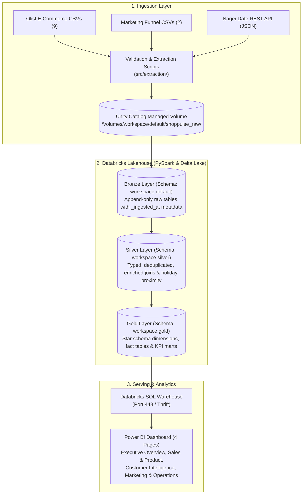

# ShopPulse: Olist E-Commerce Intelligence Platform

[](https://www.python.org/)
[](https://spark.apache.org/)
[](https://databricks.com/)
[](https://delta.io/)
[](https://powerbi.microsoft.com/)

An enterprise-grade, end-to-end Big Data Engineering and Business Intelligence platform built on the Brazilian Olist E-Commerce dataset. **ShopPulse** leverages Databricks and PySpark to implement a Medallion Architecture (Bronze, Silver, and Gold Delta Lake layers) integrated with an external public holidays REST API, culminating in an interactive four-page Microsoft Power BI executive dashboard.

---

## Table of Contents
- [1. Business Problem Statement](#1-business-problem-statement)
- [2. Project Objectives](#2-project-objectives)
- [3. Dataset Description & Attribution](#3-dataset-description--attribution)
- [4. Technology Stack](#4-technology-stack)
- [5. System Architecture & Medallion Design](#5-system-architecture--medallion-design)
  - [Bronze Layer (Raw Delta Ingestion)](#bronze-layer-raw-delta-ingestion)
  - [Silver Layer (Cleansed & Enriched Delta)](#silver-layer-cleansed--enriched-delta)
  - [Gold Layer (Curated Dimensional Marts)](#gold-layer-curated-dimensional-marts)
- [6. Databricks Implementation Notebooks](#6-databricks-implementation-notebooks)
- [7. ETL Workflow & Data Pipeline](#7-etl-workflow--data-pipeline)
- [8. Power BI Executive Dashboard](#8-power-bi-executive-dashboard)
  - [Page 1: Executive Overview](#page-1-executive-overview)
  - [Page 2: Sales and Product Analysis](#page-2-sales-and-product-analysis)
  - [Page 3: Customer Intelligence](#page-3-customer-intelligence)
  - [Page 4: Marketing and Operations](#page-4-marketing-and-operations)
- [9. Key Business Insights & Validated KPIs](#9-key-business-insights--validated-kpis)
- [10. Pipeline & Dashboard Execution Evidence](#10-pipeline--dashboard-execution-evidence)
- [11. Repository Structure](#11-repository-structure)
- [12. Setup and Execution Instructions](#12-setup-and-execution-instructions)
- [13. Limitations & Future Enhancements](#13-limitations--future-enhancements)
- [14. Team, Acknowledgements & Attribution](#14-team-acknowledgements--attribution)

---

## 1. Business Problem Statement

Operating a large multi-vendor marketplace involves complex interdependent processes spanning cross-regional customer acquisition, multi-seller fulfillment, unpredictable logistics timelines, customer feedback loops, and calendar seasonality.

Marketplace leadership teams face critical visibility challenges:
- **Revenue & Freight Realization:** Decoupling true product GMV from freight overheads across Brazilian states.
- **Customer Lifetime Value & Retention:** Distinguishing between one-time buyers and repeat purchasers to allocate acquisition spend efficiently.
- **Logistics Bottlenecks:** Pinpointing causes of delayed deliveries across Brazil's diverse geography and quantifying customer dissatisfaction resulting from late arrivals.
- **Seller & Marketing Funnel Conversion:** Tracking Marketing Qualified Leads (MQLs) through the seller onboarding funnel to identify lead conversion attrition.
- **Calendar & Holiday Seasonality:** Assessing whether statutory national holidays impede fulfillment or accelerate online orders.

---

## 2. Project Objectives

1. **Scalable Cloud Ingestion:** Ingest 100,000+ orders and 1.1+ million geolocation records into governed cloud object storage using Databricks Unity Catalog Volumes (`/Volumes/workspace/default/shoppulse_raw/`).
2. **Medallion Data Lakehouse:** Construct an automated, ACID-compliant Medallion pipeline (Bronze $\rightarrow$ Silver $\rightarrow$ Gold) using Delta Lake and PySpark across schemas `workspace.default`, `workspace.silver`, and `workspace.gold`.
3. **Data Quality & Anomaly Handling:** Enforce strict schemas, handle multi-line customer reviews, deduplicate records, and handle null timestamps.
4. **Star-Schema Dimensional Modeling:** Generate analytics-ready dimensional marts, granular fact tables, and aggregated business tables.
5. **Interactive Business Intelligence:** Build a high-performance, 4-page Power BI dashboard connected to Databricks SQL with validated DAX measures.

---

## 3. Dataset Description & Attribution

The platform integrates two Kaggle open datasets alongside a live external REST API:

| Data Asset | Source | Records | Attributes / Description |
| :--- | :--- | :---: | :--- |
| **Olist Brazilian E-Commerce** | [Kaggle Olist Dataset](https://www.kaggle.com/datasets/olistbr/brazilian-ecommerce) | 100,000+ Orders | 9 relational tables: orders, items, customers, products, payments, reviews, sellers, geolocation, and Portuguese-English translations. |
| **Olist Marketing Funnel** | [Kaggle Marketing Funnel](https://www.kaggle.com/datasets/olistbr/marketing-funnel-olist) | 8,000 Leads | 2 tables: Marketing Qualified Leads (MQLs) and Closed Deals (842 seller wins). |
| **Brazilian Public Holidays** | [Nager.Date REST API](https://date.nager.at/) | 42 Holidays | Statutory and bank holidays across Brazil for 2016, 2017, and 2018. |

*Provider Note:* The Olist Brazilian E-Commerce dataset and the Olist Marketing Funnel dataset are separate analytical assets provided by the same source organization (Olist).  
*Dataset Licensing:* The Olist datasets are published on Kaggle under the **Creative Commons Attribution-NonCommercial-ShareAlike 4.0 International (CC BY-NC-SA 4.0)** license. For the Nager.Date Public Holidays API, verify specific data reuse terms before formal submission.

---

## 4. Technology Stack

- **Storage & Governance:** Databricks Unity Catalog Managed Volumes (`/Volumes/workspace/default/shoppulse_raw/`)
- **Compute Engine:** Apache Spark 3.5+ (Databricks Runtime 14.3 LTS / Serverless PySpark)
- **Table Format:** Delta Lake (ACID transactions, time-travel, partition optimization)
- **Programming & Scripting:** Python 3.12, PySpark, PowerShell, SQL, DAX
- **Serving Layer:** Databricks SQL Warehouse (DirectQuery / Import via Thrift API on Port 443)
- **Business Intelligence:** Microsoft Power BI Desktop (4-page interactive dashboard, Star Schema, custom DAX)
- **Version Control:** Git & GitHub

---

## 5. System Architecture & Medallion Design



### Bronze Layer (Raw Delta Ingestion — `workspace.default`)
- Reads raw CSV and JSON files directly from Unity Catalog Volume `/Volumes/workspace/default/shoppulse_raw/`.
- Preserves full schema fidelity without loss of source records (100% row-count parity).
- Adds metadata audit columns: `_ingested_at` (UTC timestamp) and `_source_file`.
- Implements specialized CSV parsing with `multiLine=True` and `escape='"'` to prevent record corruption on customer review text containing newlines.
- Tables: `bronze_orders`, `bronze_order_items`, `bronze_customers`, `bronze_products`, `bronze_sellers`, `bronze_payments`, `bronze_reviews`, `bronze_geolocation`, `bronze_category_translation`, `bronze_marketing_qualified_leads`, `bronze_closed_deals`, `bronze_brazil_public_holidays`.

### Silver Layer (Cleansed & Enriched Delta — `workspace.silver`)
- **Schema & Type Enforcement:** Casts monetary amounts to `Double`, identifiers to clean strings, and date strings to ISO `Timestamp`.
- **Deduplication:** Deduplicates orders and review records on primary business keys.
- **Relational Joins:** Resolves English category translations from Portuguese naming (`silver_products`).
- **Holiday Tagging:** Enriches orders with boolean flags and day offsets against Brazilian public holiday dates to isolate seasonal fulfillment friction.
- Tables: `silver_orders`, `silver_customers`, `silver_order_items`, `silver_products`, `silver_sellers`, `silver_payments`, `silver_reviews`, `silver_geolocation`, `silver_marketing_qualified_leads`, `silver_closed_deals`.

### Gold Layer (Curated Dimensional Marts — `workspace.gold`)
- **Dimensions:** `dim_date`, `dim_products`, `dim_sellers`, `dim_customers`, `dim_geolocation`.
- **Fact Tables:**
  - `fact_sales`: 98,666 orders with fulfilled items, product GMV, freight, and net values.
  - `fact_payments`: 103,886 payment records across payment types and installment counts.
  - `fact_reviews`: 99,224 review scores, sentiment ratings, and response times.
  - `fact_marketing_conversion`: 8,000 MQLs, 842 closed deals, and conversion time intervals.
  - `fact_orders`: Master fact tracking all 99,441 registered orders across all lifecycle statuses.
- **Analytical & KPI Marts:**
  - `kpi_executive_summary`: High-level executive scorecard (AOV: R$ 160.58).
  - `kpi_monthly_sales` & `kpi_monthly_payments`: Monthly revenue, freight, and installment trends.
  - `kpi_top_10_categories` & `kpi_sales_by_category`: Category revenue rankings and volume shares.
  - `kpi_sales_by_state` & `kpi_sales_by_seller_state`: Geographic sales distributions.
  - `kpi_monthly_delivery`: 93.13% on-time delivery rate, carrier transit times, and delay severity.
  - `kpi_monthly_marketing`: Lead generation velocity and acquisition channel conversions.
  - `kpi_reviews_by_state` & `kpi_monthly_reviews`: Customer satisfaction ratings by region.
  - `agg_customer_behavior`: Customer profile mart (95,420 unique purchasers, 3.05% repeat rate).
  - `kpi_customer_segments` & `kpi_monthly_customer_acquisition`: Retention and acquisition metrics.

---

## 6. Databricks Implementation Notebooks

The full Lakehouse processing engine is authored and saved across two production Jupyter/Databricks notebooks in the repository:

```text
notebooks/
├── 01_Raw_Bronze_Silver_Pipeline.ipynb  <- Ingestion, Bronze creation & Silver cleansing
└── gold/
    └── 02_Gold_Layer_Analytics.ipynb    <- Star-schema dimensions, facts & business KPI marts
```

### Notebook 1: `notebooks/01_Raw_Bronze_Silver_Pipeline.ipynb` (1.24 MB, 193 Cells)
- **Scope:** Raw volume verification, Bronze ingestion, and Silver layer transformations.
- **Key Operations:**
  - Connects to `/Volumes/workspace/default/shoppulse_raw/`.
  - Audits raw files and verifies multi-line review parsing.
  - Creates 12 append-only Bronze Delta tables in `workspace.default`.
  - Cleanses, deduplicates, casts types, and enforces relational integrity into `workspace.silver`.
  - Saved outputs document complete row-count parity and validation assertions.

### Notebook 2: `notebooks/gold/02_Gold_Layer_Analytics.ipynb` (10.42 MB, 114 Cells)
- **Scope:** Star-schema dimensional modeling, fact table engineering, customer RFM profiling, and KPI calculation across 25 Gold tables.
- **Key Operations:**
  - Builds 5 Gold dimensions (`dim_date`, `dim_products`, `dim_sellers`, `dim_customers`, `dim_geolocation`).
  - Constructs 5 granular fact tables (`fact_sales`, `fact_payments`, `fact_reviews`, `fact_marketing_conversion`, `fact_orders`).
  - Aggregates 14 analytical KPI marts (`kpi_executive_summary`, `kpi_monthly_sales`, `kpi_monthly_payments`, `kpi_sales_by_category`, `kpi_top_10_categories`, `kpi_sales_by_state`, `kpi_sales_by_seller_state`, `kpi_monthly_delivery`, `kpi_monthly_marketing`, `kpi_monthly_reviews`, `kpi_reviews_by_state`, `agg_customer_behavior`, `kpi_customer_segments`, `kpi_monthly_customer_acquisition`) and 1 audit table (`geolocation_location_audit`).
  - Saved outputs document live query executions and KPI verification results.

> **Execution Sequence:**  
> The notebooks are designed for Databricks Serverless or All-Purpose Compute (Runtime 14.3+ LTS). They must be executed **sequentially**:
> 1. Run `notebooks/01_Raw_Bronze_Silver_Pipeline.ipynb` to establish the raw storage mounts and populate `workspace.default` and `workspace.silver`.
> 2. Run `notebooks/gold/02_Gold_Layer_Analytics.ipynb` to process the Silver Delta tables and generate `workspace.gold`.

---

## 7. ETL Workflow & Data Pipeline

1. **Extraction:** `src/extraction/api_extract_holidays.py` queries the Nager.Date REST API for years 2016–2018, writing structured JSON payloads and consolidated CSVs to `data/raw/`.
2. **Pre-Flight Validation:** `src/extraction/validate_raw_files.py` verifies record counts, delimiter integrity, and null profiles across all source files.
3. **Volume Ingestion:** Source files are staged into Databricks Unity Catalog Volume `/Volumes/workspace/default/shoppulse_raw/`.
4. **PySpark Pipeline Execution:** Databricks notebooks execute the sequential transformations, writing partitioned Delta tables into schemas `workspace.default`, `workspace.silver`, and `workspace.gold`.
5. **Power BI Ingestion:** Power BI connects to the Databricks SQL Warehouse to ingest Gold tables and compute downstream business metrics.

---

## 8. Power BI Executive Dashboard

The production dashboard (`powerbi/ShopPulse_Dashboard.pbix` and `powerbi/Olist_Ecommerce_Intelligence.pbix`, 476 KB) consists of four structured pages:

### Page 1: Executive Overview
- **Core Visuals:** High-level KPI summary cards (Total Orders, Net Product Sales, Freight Overhead, Average Order Value), chronological monthly sales trend line chart, top-performing product categories bar chart, and payment method split.
- **Interactive Slicers:** Year-Month chronological slicer with blank-safe filtering, and order status cross-filtering.

### Page 2: Sales and Product Analysis
- **Core Visuals:** Category performance matrix, top 10 categories ranked by GMV, regional sales distribution across Brazilian states (SP, RJ, MG leads), and average freight ratio comparisons.
- **Insights:** São Paulo accounts for over 41% of national order volume, benefiting from substantially lower average delivery fees compared to the North/Northeast states.

### Page 3: Customer Intelligence
- **Core Visuals:** Customer segmentation distribution (One-time vs. Repeat), Customer Lifetime Value (CLV) trend, average spend per customer, and repeat purchase frequency histograms.
- **Insights:** Confirms a 3.05% marketplace repeat customer rate, reflecting an acquisition-heavy customer journey where 96.95% of customers complete single orders.

### Page 4: Marketing and Operations
- **Core Visuals:** Delivery status breakdown (On-Time/Early vs. Late), monthly delivery performance trend, MQL lead distribution by acquisition channel, lead-to-deal conversion funnel, and customer review scores by state.
- **Insights:** 93.13% on-time delivery rate. Organic search and paid search are the largest lead sources, converting at an overall 10.53% rate to closed seller partnerships.

---

## 9. Key Business Insights & Validated KPIs

All figures have been mathematically verified across Databricks PySpark and Power BI DAX:

| Metric Category | Business Indicator | Validated Value | Note / Calculation Formula |
| :--- | :--- | :---: | :--- |
| **Marketplace Scale** | Total Registered Orders | **99,441** | All order lifecycle statuses in `olist_orders_dataset` / `fact_orders` |
| | Orders with Items | **98,666** | Orders represented in `fact_sales` (775 registered orders do not have corresponding order-item records in the transaction dataset) |
| | Total Order Items | **112,650** | Individual SKU items fulfilled across all orders (`fact_sales` contains 112,650 order-item rows for 98,666 distinct orders) |
| | Unique Products | **32,951** | Catalog breadth across 71 product categories |
| | Active Sellers | **3,095** | Merchants fulfilling orders in marketplace directory |
| **Financial Performance** | Total Marketplace Revenue | **R$ 15,843,553.24** | Product GMV (R$ 13,591,643.70) + Freight (R$ 2,251,909.54) |
| | Product Sales (Net GMV) | **R$ 13,591,643.70** | Excludes shipping charges and carrier fees |
| | Total Freight Value | **R$ 2,251,909.54** | Total shipping fees collected |
| | **Average Order Value (AOV)** | **R$ 160.58** | $\frac{\text{Sales Including Freight (R\$ 15,843,553.24)}}{\text{Orders with Items (98,666)}} = \text{R\$ 160.58}$ (verified in `workspace.gold.kpi_executive_summary`) |
| **Customer Intelligence** | Unique Purchasing Customers | **95,420** | Deduplicated customer entities (`customer_unique_id`) |
| | Average Spend per Customer | **R$ 166.04** | Total revenue (R$ 15,843,553.24) / 95,420 unique purchasers |
| | Repeat Customer Rate | **3.05%** | Customers with $\ge 2$ completed orders (2,913 repeat / 95,420 total) |
| **Logistics & Delivery** | Delivered Orders | **96,478** | Confirmed customer delivery receipts |
| | On-Time / Early Orders | **89,853** | Delivered on or before carrier estimated date |
| | Late Delivery Orders | **6,533** | Delivered after estimated date |
| | Unknown Delivery Dates | **92** | Orders marked `delivered` with unrecorded customer delivery timestamp |
| | On-Time Delivery Rate | **93.13%** | On-time orders (89,853) / delivered orders (96,478) (92 unknown delivery records tracked separately) |
| | Average Review Rating | **4.09 / 5.00** | Across 99,224 customer reviews |
| **Marketing Funnel** | Marketing Qualified Leads (MQLs) | **8,000** | Inbound seller leads captured via landing pages |
| | Closed Deals (Onboarded Sellers) | **842** | Signed marketplace merchants (10.53% conversion rate) |
| | Matched Active Sellers | **380** | Closed-deal sellers with active order fulfillment history |

> **Note on Average Order Value (AOV):**  
> In the executive Gold mart (`workspace.gold.kpi_executive_summary`), AOV is defined as total transaction value per fulfilled order: $\frac{\text{R\$ 15,843,553.24}}{98,666} = \text{R\$ 160.58}$. If evaluated against net product sales excluding freight, the ratio is $\frac{\text{R\$ 13,591,643.70}}{98,666} = \text{R\$ 137.75}$. If evaluated against all 99,441 registered orders (including orders without item assignments), the ratio is $\frac{\text{R\$ 15,843,553.24}}{99,441} = \text{R\$ 159.32}$.

---

## 10. Pipeline & Dashboard Execution Evidence

Visual evidence documenting the actual execution of the Databricks Lakehouse pipelines and the live Power BI dashboard is cataloged in [`docs/screenshots/`](docs/screenshots/):

| Pipeline Stage / View | Description | File Link |
| :--- | :--- | :---: |
| **Silver Layer Quality Audit** | Verification cell from `notebooks/01_Raw_Bronze_Silver_Pipeline.ipynb` confirming all 11 Silver Delta tables passed row-count and integrity assertions with 0 failures. | [View Screenshot](docs/screenshots/01_silver_audit_pass.png) |
| **Gold Catalog Verification** | Databricks Unity Catalog Lakehouse inventory verifying registered tables across Bronze, Silver, and Gold schemas. | [View Screenshot](docs/screenshots/02_gold_table_inventory.png) |
| **Gold Executive KPIs Output** | Execution output from `notebooks/gold/02_Gold_Layer_Analytics.ipynb` displaying `kpi_executive_summary` with 98,666 orders with items, 112,650 order items, R\$ 15.84M gross revenue, and R\$ 160.58 AOV. | [View Screenshot](docs/screenshots/03_gold_executive_kpis.png) |
| **Delivery Performance Breakdown** | Execution output from `notebooks/gold/02_Gold_Layer_Analytics.ipynb` validating `fact_orders` delivery categorization (89,853 on-time, 6,533 late, 2,963 not applicable, 92 unknown). | [View Screenshot](docs/screenshots/04_gold_delivery_performance.png) |
| **Power BI: Executive Overview** | Page 1 of the interactive Power BI dashboard (`ShopPulse_Dashboard.pbix`) connected to Databricks SQL Warehouse, showcasing executive KPI cards and monthly trends. | [View Screenshot](docs/screenshots/05_powerbi_dashboard_overview.png) |
| **Power BI: Sales & Category Analysis** | Page 2 of the Power BI dashboard displaying product category GMV rankings, geographic sales distributions, and seller state breakdown. | [View Screenshot](docs/screenshots/06_powerbi_sales_analysis.png) |

---

## 11. Repository Structure

```text
ShopPulse-Olist-Ecommerce-Intelligence/
│
├── .env.example                                      <- Environment template (no secrets)
├── .gitignore                                        <- Excludes secrets, large CSVs, and temp files
├── README.md                                         <- Master project documentation and architecture guide
├── PROJECT_PLAN.md                                   <- Project lifecycle, status, and execution roadmap
├── DATA_SOURCE_REGISTER.md                           <- Verified schemas, join keys, and source licenses
├── TEAM_RESPONSIBILITIES.md                          <- Role assignments, workflow matrix, and defense guide
├── ARCHITECTURE.md                                   <- In-depth technical architecture and system design
├── requirements.txt                                  <- Python dependencies
│
├── 01_Raw_Data_Acces_Verification - Databricks.html  <- Exported Databricks verification notebook
├── 01_Raw_Data_Acces_Verification - Databricks_files/
│
├── notebooks/
│   ├── 01_Raw_Bronze_Silver_Pipeline.ipynb           <- Raw verification, Bronze Delta creation & Silver cleansing
│   └── gold/
│       └── 02_Gold_Layer_Analytics.ipynb             <- Gold dimensions, facts, customer RFM, marketing & KPIs
│
├── data/
│   ├── README.md                                     <- Data documentation and external download guide
│   ├── raw/                                          <- Staging directory (.gitkeep)
│   ├── processed/                                    <- Intermediary directory (.gitkeep)
│   └── gold_exports/                                 <- Gold marts export directory (.gitkeep)
│
├── powerbi/
│   ├── ShopPulse_Dashboard.pbix                      <- Final production Power BI interactive dashboard (476 KB)
│   ├── Olist_Ecommerce_Intelligence.pbix              <- Primary Power BI report (identical verified hash)
│   ├── build_dashboard.py                            <- Automated Power BI layout generator
│   ├── refine_dashboard.py                           <- Visual refinement and container builder
│   └── quality_check_dashboard.py                    <- DAX measure and model quality audit suite
│
├── src/
│   ├── extraction/
│   │   ├── api_extract_holidays.py                   <- Ingests Brazilian national holidays via REST API
│   │   ├── validate_raw_files.py                     <- Validates schemas and counts of raw files
│   │   └── secondary_audit.py                        <- Audits cross-table foreign key relationships
│   │
│   └── utils/
│       ├── config.py                                 <- Configuration and path resolver
│       └── logger.py                                 <- Structured execution logging utility
│
└── docs/
    ├── screenshots/                                  <- Visual execution evidence (Databricks & Power BI)
    │   ├── 01_silver_audit_pass.png
    │   ├── 02_gold_table_inventory.png
    │   ├── 03_gold_executive_kpis.png
    │   ├── 04_gold_delivery_performance.png
    │   ├── 05_powerbi_dashboard_overview.png
    │   └── 06_powerbi_sales_analysis.png
    ├── DATA_VALIDATION_REPORT.md                     <- Pre-ingestion file audit and record validation
    ├── PHASE_1A_SECONDARY_AUDIT.md                   <- Relational integrity and null checks
    ├── PHASE_1B_API_EXTRACTION_REPORT.md             <- Holiday API response validation
    └── PHASE_1C_DATABRICKS_ACCESS_REPORT.md          <- Unity Catalog volume access report
```

---

## 12. Setup and Execution Instructions

### Prerequisites
- Python 3.10+ (Python 3.12 recommended)
- Git 2.40+
- Microsoft Power BI Desktop (Latest version)
- Databricks Workspace (Serverless or All-Purpose Compute with Unity Catalog enabled)

### Step 1: Clone Repository
```bash
git clone https://github.com/pratyush-max/ShopPulse-Olist-Ecommerce-Intelligence.git
cd ShopPulse-Olist-Ecommerce-Intelligence
```

### Step 2: Environment Configuration
```powershell
# Create and activate virtual environment
python -m venv venv
.\venv\Scripts\Activate.ps1

# Install required dependencies
pip install -r requirements.txt

# Create local environment config from template
Copy-Item .env.example .env
```

### Step 3: Run Public Holiday Extraction & Validation
```bash
python src/extraction/api_extract_holidays.py
python src/extraction/validate_raw_files.py
```

### Step 4: Databricks Ingestion & Execution
1. Create a Managed Volume inside Databricks: `/Volumes/workspace/default/shoppulse_raw/`.
2. Upload the raw CSV and JSON files into the Volume.
3. Import the notebooks into your Databricks workspace:
   - Import `notebooks/01_Raw_Bronze_Silver_Pipeline.ipynb`.
   - Import `notebooks/gold/02_Gold_Layer_Analytics.ipynb`.
4. Run `01_Raw_Bronze_Silver_Pipeline.ipynb` to establish Bronze Delta tables in `workspace.default` and Silver Delta tables in `workspace.silver`.
5. Run `02_Gold_Layer_Analytics.ipynb` to generate Gold dimensions, fact tables, and KPI marts in `workspace.gold`.

### Step 5: Power BI Reporting
Open `powerbi/ShopPulse_Dashboard.pbix` in Microsoft Power BI Desktop. The report connects directly to the Databricks SQL Warehouse (Port 443) to refresh and query live data.

---

## 13. Limitations & Future Enhancements

- **Geographic Representation:** Geolocation coordinate files contain multiple zip-code prefix duplicates; implementing geospatial polygon clustering with H3 indexing would enhance spatial precision.
- **Streaming Ingestion:** Current pipeline runs in scheduled batch micro-batches; migrating to Databricks Delta Live Tables (DLT) with Auto Loader would enable near real-time streaming ingestion.
- **Predictive Customer Modeling:** Extending Gold layers to calculate predictive churn probabilities and next-purchase timing using Spark MLlib.

---

## 14. Team, Acknowledgements & Attribution

### Project Team
- **Pratyush Pratim Thakur** ([@pratyush-max](https://github.com/pratyush-max)) — Team Lead
  - *Responsibilities:* [Placeholder — To be finalized by team: Overall Architecture, Project Lead, Lakehouse Orchestration, Repository Management]
- **Anuj** — Team Member
  - *Responsibilities:* [Placeholder — To be finalized by team: Data Engineering, Pipeline Implementation, Ingestion & Quality Auditing]
- **Chirag** — Team Member
  - *Responsibilities:* [Placeholder — To be finalized by team: Business Intelligence, Dashboard Analytics, DAX Modeling, Documentation]

### Technology & Tool Acknowledgements
The team acknowledges the open-source software, cloud platforms, and developer tools that made this project possible:
- **Python** (Python Software Foundation) — Primary data extraction and validation scripting language.
- **Apache Spark & PySpark** (Apache Software Foundation) — Distributed compute and large-scale data processing engine.
- **Delta Lake** (Linux Foundation) — ACID transaction layer, time travel, and lakehouse storage format.
- **Databricks** — Unified Lakehouse platform and serverless Spark compute environment.
- **Microsoft Power BI** — Interactive enterprise business intelligence, semantic modeling, and DAX analytics.
- **Git & GitHub** — Distributed version control and collaboration platform.

### Dataset Citations & Licensing
- **Olist Brazilian E-Commerce & Marketing Funnel Datasets:** Provided by Olist and André Sionek on [Kaggle](https://www.kaggle.com/datasets/olistbr/brazilian-ecommerce) under the Creative Commons Attribution-NonCommercial-ShareAlike 4.0 International (CC BY-NC-SA 4.0) license. Both datasets originate from the same provider organization (Olist).
- **Brazilian Public Holidays API:** Provided by [Nager.Date](https://date.nager.at/) under open REST API access (verify before submission).
