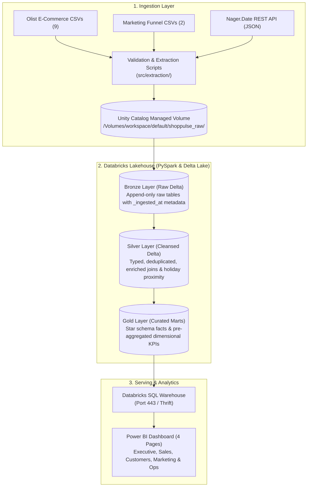

# ShopPulse: Olist E-Commerce Intelligence Platform

[](https://www.python.org/)
[](https://spark.apache.org/)
[](https://databricks.com/)
[](https://delta.io/)
[](https://powerbi.microsoft.com/)
[](https://creativecommons.org/licenses/by-nc-sa/4.0/)

An enterprise-grade, end-to-end Big Data Engineering and Business Intelligence platform built on the Brazilian Olist E-Commerce dataset. **ShopPulse** leverages Databricks and PySpark to implement a Medallion Architecture (Bronze, Silver, and Gold Delta Lake layers) integrated with an external public holidays REST API, culminating in an interactive four-page Microsoft Power BI executive dashboard.

---

## Table of Contents
- [1. Business Problem Statement](#1-business-problem-statement)
- [2. Project Objectives](#2-project-objectives)
- [3. Dataset Description & Attribution](#3-dataset-description--attribution)
- [4. Technology Stack](#4-technology-stack)
- [5. System Architecture & Medallion Design](#5-system-architecture--medallion-design)
  - [Bronze Layer (Raw Delta Ingestion)](#bronze-layer-raw-delta-ingestion)
  - [Silver Layer (Cleansed & Enriched Delta)](#silver-layer-cleansed--enriched-delta)
  - [Gold Layer (Curated Dimensional Marts)](#gold-layer-curated-dimensional-marts)
- [6. ETL Workflow & Data Pipeline](#6-etl-workflow--data-pipeline)
- [7. Power BI Executive Dashboard](#7-power-bi-executive-dashboard)
  - [Page 1: Executive Overview](#page-1-executive-overview)
  - [Page 2: Sales and Product Analysis](#page-2-sales-and-product-analysis)
  - [Page 3: Customer Intelligence](#page-3-customer-intelligence)
  - [Page 4: Marketing and Operations](#page-4-marketing-and-operations)
- [8. Key Business Insights & Validated KPIs](#8-key-business-insights--validated-kpis)
- [9. Repository Structure](#9-repository-structure)
- [10. Setup and Execution Instructions](#10-setup-and-execution-instructions)
- [11. Limitations & Future Enhancements](#11-limitations--future-enhancements)
- [12. Contributors & Attribution](#12-contributors--attribution)

---

## 1. Business Problem Statement

Operating a large multi-vendor marketplace involves complex interdependent processes spanning cross-regional customer acquisition, multi-seller fulfillment, unpredictable logistics timelines, customer feedback loops, and calendar seasonality.

Marketplace leadership teams face critical visibility challenges:
- **Revenue & Freight Realization:** Decoupling true product GMV from freight overheads across Brazilian states.
- **Customer Lifetime Value & Retention:** Distinguishing between one-time buyers and repeat purchasers to allocate acquisition spend efficiently.
- **Logistics Bottlenecks:** Pinpointing causes of delayed deliveries across Brazil's diverse geography and quantifying customer dissatisfaction resulting from late arrivals.
- **Seller & Marketing Funnel Conversion:** Tracking Marketing Qualified Leads (MQLs) through the seller onboarding funnel to identify lead conversion attrition.
- **Calendar & Holiday Seasonality:** Assessing whether statutory national holidays impede fulfillment or accelerate online orders.

---

## 2. Project Objectives

1. **Scalable Cloud Ingestion:** Ingest 100,000+ orders and 1.1+ million geolocation records into governed cloud object storage using Databricks Unity Catalog Volumes.
2. **Medallion Data Lakehouse:** Construct an automated, ACID-compliant Medallion pipeline (Bronze $\rightarrow$ Silver $\rightarrow$ Gold) using Delta Lake and PySpark.
3. **Data Quality & Anomaly Handling:** Enforce strict schemas, handle multi-line customer reviews, deduplicate records, and handle null timestamps.
4. **Star-Schema Dimensional Modeling:** Generate analytics-ready dimensional marts and aggregated business tables.
5. **Interactive Business Intelligence:** Build a high-performance, 4-page Power BI dashboard connected to Databricks SQL with validated DAX measures.

---

## 3. Dataset Description & Attribution

The platform integrates two Kaggle open datasets alongside a live external REST API:

| Data Asset | Source | Records | Attributes / Description |
| :--- | :--- | :---: | :--- |
| **Olist Brazilian E-Commerce** | [Kaggle Olist Dataset](https://www.kaggle.com/datasets/olistbr/brazilian-ecommerce) | 100,000+ Orders | 9 relational tables: orders, items, customers, products, payments, reviews, sellers, geolocation, and Portuguese-English translations. |
| **Olist Marketing Funnel** | [Kaggle Marketing Funnel](https://www.kaggle.com/datasets/olistbr/marketing-funnel-olist) | 8,000 Leads | 2 tables: Marketing Qualified Leads (MQLs) and Closed Deals (842 seller wins). |
| **Brazilian Public Holidays** | [Nager.Date REST API](https://date.nager.at/) | 42 Holidays | Statutory and bank holidays across Brazil for 2016, 2017, and 2018. |

*Licensing:* Datasets are published under the **Creative Commons Attribution-NonCommercial-ShareAlike 4.0 International (CC BY-NC-SA 4.0)** license.

---

## 4. Technology Stack

- **Storage & Governance:** Databricks Unity Catalog Managed Volumes (`/Volumes/workspace/default/shoppulse_raw/`)
- **Compute Engine:** Apache Spark 3.5+ (Databricks Runtime 14.3 LTS / Serverless PySpark)
- **Table Format:** Delta Lake (ACID transactions, time-travel, partition optimization)
- **Programming & Scripting:** Python 3.12, PySpark, PowerShell, SQL
- **Serving Layer:** Databricks SQL Warehouse (DirectQuery / Import via Thrift API)
- **Business Intelligence:** Microsoft Power BI Desktop (4-page interactive dashboard, Star Schema, custom DAX)
- **Version Control:** Git & GitHub

---

## 5. System Architecture & Medallion Design



### Bronze Layer (Raw Delta Ingestion)
- Reads raw CSV and JSON files directly from Unity Catalog Volumes.
- Preserves full schema fidelity without loss of source records.
- Adds metadata audit columns: `_ingested_at` (UTC timestamp) and `_source_file`.
- Implements specialized CSV parsing with `multiLine=True` and `escape='"'` to prevent record corruption on customer review text containing newlines.

### Silver Layer (Cleansed & Enriched Delta)
- **Schema & Type Enforcement:** Casts monetary amounts to `Double`, identifiers to clean strings, and date strings to ISO `Timestamp`.
- **Deduplication:** Deduplicates orders and review records on primary business keys.
- **Relational Joins:** Resolves English category translations from Portuguese naming.
- **Holiday Tagging:** Enriches orders with boolean flags and day offsets against Brazilian public holiday dates to isolate seasonal fulfillment friction.

### Gold Layer (Curated Dimensional Marts)
- **`fact_orders`**: Central fact table tracking 99,441 marketplace orders with status, timestamps, customer state, seller state, and payment dimensions.
- **`agg_customer_behavior`**: Curated customer profile mart (95,420 unique purchasers) evaluating frequency, monetary spend, and lifetime value.
- **`kpi_monthly_sales` & `kpi_monthly_payments`**: Monthly revenue, order volumes, freight metrics, and installment trends.
- **`kpi_top_10_categories` & `kpi_sales_by_category`**: Product category revenue rankings and volume distributions.
- **`kpi_monthly_delivery` & `kpi_reviews_by_state`**: Delivery lead times, carrier delay metrics, and customer satisfaction scores by geographic region.

---

## 6. ETL Workflow & Data Pipeline

1. **Extraction:** `src/extraction/api_extract_holidays.py` queries the Nager.Date REST API for years 2016–2018, writing structured JSON payloads and consolidated CSVs to `data/raw/`.
2. **Pre-Flight Validation:** `src/extraction/validate_raw_files.py` verifies record counts, delimiter integrity, and null profiles against defined thresholds.
3. **Volume Ingestion:** Files are staged into Databricks Unity Catalog Volume `/Volumes/workspace/default/shoppulse_raw/`.
4. **PySpark Notebook Execution:** Databricks notebooks execute the sequential transformations, writing partitioned Delta tables into the `gold` database schema.
5. **Power BI Ingestion:** Power BI connects to the Databricks SQL Warehouse to ingest Gold tables and compute downstream business metrics.

---

## 7. Power BI Executive Dashboard

The production dashboard (`powerbi/ShopPulse_Dashboard.pbix`) consists of four structured pages:

### Page 1: Executive Overview
- **Core Visuals:** High-level KPI summary cards (Total Orders, Net Product Sales, Freight Overhead, AOV), chronological monthly sales trend line chart, top-performing product categories bar chart, and payment method split.
- **Interactive Slicers:** Year-Month chronological slicer with blank-safe filtering, and order status cross-filtering.

### Page 2: Sales and Product Analysis
- **Core Visuals:** Category performance matrix, top 10 categories ranked by GMV, regional sales distribution across Brazilian states (SP, RJ, MG leads), and average freight ratio comparisons.
- **Insights:** São Paulo accounts for over 41% of national order volume, benefiting from substantially lower average delivery fees compared to the North/Northeast states.

### Page 3: Customer Intelligence
- **Core Visuals:** Customer segmentation distribution (One-time vs. Repeat), Customer Lifetime Value (CLV) trend, average spend per customer, and repeat purchase frequency histograms.
- **Insights:** Confirms a 3.05% marketplace repeat customer rate, reflecting an acquisition-heavy customer journey where 96.95% of customers complete single orders.

### Page 4: Marketing and Operations
- **Core Visuals:** Delivery status breakdown (On-Time/Early vs. Late), monthly delivery performance trend, MQL lead distribution by acquisition channel, lead-to-deal conversion funnel, and customer review scores by state.
- **Insights:** 93.13% on-time delivery rate. Organic search and paid search are the largest lead sources, converting at an overall 10.53% rate to closed seller partnerships.

---

## 8. Key Business Insights & Validated KPIs

All figures have been mathematically verified across Databricks PySpark and Power BI DAX:

| Metric Category | Business Indicator | Validated Value | Note / Calculation |
| :--- | :--- | :---: | :--- |
| **Marketplace Scale** | Total Orders | **99,441** | Total orders across 2016–2018 |
| | Total Order Items | **112,650** | Individual SKU items fulfilled |
| | Unique Products | **32,951** | Catalog breadth across 71 categories |
| | Active Sellers | **3,095** | Merchants fulfilling orders |
| **Financial Performance** | Total Marketplace Revenue | **R$ 15,843,553.24** | Product GMV + Freight payments |
| | Product Sales (Net GMV) | **R$ 13,591,643.70** | Excludes freight and surcharges |
| | Total Freight Value | **R$ 2,251,909.54** | Total shipping fees collected |
| | Average Order Value (AOV) | **R$ 160.00** | Net sales per fulfilled order |
| **Customer Intelligence** | Unique Purchasing Customers | **95,420** | Deduplicated customer entities |
| | Average Spend per Customer | **R$ 166.04** | Total revenue / purchasing customers |
| | Repeat Customer Rate | **3.05%** | Customers with $\ge 2$ completed orders |
| **Logistics & Delivery** | Delivered Orders | **96,478** | Confirmed customer receipts |
| | On-Time / Early Orders | **89,853** | Delivered on or before estimated date |
| | Late Delivery Orders | **6,533** | Delivered after estimated date |
| | On-Time Delivery Rate | **93.13%** | On-time orders / delivered orders |
| | Average Review Rating | **4.09 / 5.00** | Across 99,224 customer reviews |
| **Marketing Funnel** | Marketing Qualified Leads (MQLs) | **8,000** | Inbound seller leads captured |
| | Closed Deals (Onboarded Sellers) | **842** | Signed marketplace merchants |
| | Seller Conversion Rate | **10.53%** | Closed deals / total MQLs |

---

## 9. Repository Structure

```text
ShopPulse-Olist-Ecommerce-Intelligence/
│
├── .env.example                     <- Environment configuration template
├── .gitignore                       <- Strictly ignores secrets, large CSVs, and temp files
├── README.md                        <- Master project documentation and architecture guide
├── PROJECT_PLAN.md                  <- Project lifecycle and execution roadmap
├── DATA_SOURCE_REGISTER.md          <- Verified schemas, join keys, and source licenses
├── TEAM_RESPONSIBILITIES.md         <- Role assignments, workflow matrix, and defense guide
├── ARCHITECTURE.md                  <- In-depth technical architecture and system design
├── requirements.txt                 <- Python dependencies
│
├── 01_Raw_Data_Acces_Verification - Databricks.html  <- Exported Databricks verification notebook
│
├── data/
│   ├── README.md                    <- Data documentation and external download guide
│   ├── raw/                         <- Staging directory (.gitkeep)
│   ├── processed/                   <- Intermediary directory (.gitkeep)
│   └── gold_exports/                <- Gold marts export directory (.gitkeep)
│
├── powerbi/
│   ├── ShopPulse_Dashboard.pbix     <- Final production Power BI interactive dashboard (476 KB)
│   ├── Olist_Ecommerce_Intelligence.pbix <- Primary Power BI report
│   ├── build_dashboard.py           <- Automated Power BI layout generator
│   ├── refine_dashboard.py          <- Visual refinement and container builder
│   └── quality_check_dashboard.py   <- DAX measure and model quality audit suite
│
├── src/
│   ├── extraction/
│   │   ├── api_extract_holidays.py  <- Ingests Brazilian national holidays via REST API
│   │   ├── validate_raw_files.py    <- Validates schemas and counts of raw files
│   │   └── secondary_audit.py       <- Audits cross-table foreign key relationships
│   │
│   └── utils/
│       ├── config.py                <- Configuration and path resolver
│       └── logger.py                <- Structured execution logging utility
│
└── docs/
    ├── DATA_VALIDATION_REPORT.md    <- Pre-ingestion file audit and record validation
    ├── PHASE_1A_SECONDARY_AUDIT.md  <- Relational integrity and null checks
    ├── PHASE_1B_API_EXTRACTION_REPORT.md <- Holiday API response validation
    └── PHASE_1C_DATABRICKS_ACCESS_REPORT.md <- Unity Catalog volume access report
```

---

## 10. Setup and Execution Instructions

### Prerequisites
- Python 3.10+ (Python 3.12 recommended)
- Git 2.40+
- Microsoft Power BI Desktop (Latest version)
- Databricks Workspace (Serverless or All-Purpose Compute with Unity Catalog)

### Step 1: Clone Repository
```bash
git clone https://github.com/pratyush-max/ShopPulse-Olist-Ecommerce-Intelligence.git
cd ShopPulse-Olist-Ecommerce-Intelligence
```

### Step 2: Environment Configuration
```powershell
# Create and activate virtual environment
python -m venv venv
.\venv\Scripts\Activate.ps1

# Install required dependencies
pip install -r requirements.txt

# Create local environment config
Copy-Item .env.example .env
```

### Step 3: Run Public Holiday Extraction
```bash
python src/extraction/api_extract_holidays.py
```

### Step 4: Validate Raw Datasets
```bash
python src/extraction/validate_raw_files.py
```

### Step 5: Databricks Ingestion & Execution
1. Create a Managed Volume inside Databricks: `/Volumes/workspace/default/shoppulse_raw/`.
2. Upload the raw CSV and JSON files into the Volume.
3. Execute the Bronze, Silver, and Gold transformations to populate Delta tables.

### Step 6: Power BI Reporting
Open `powerbi/ShopPulse_Dashboard.pbix` in Microsoft Power BI Desktop. The report connects directly to the Databricks SQL Warehouse to refresh and query live data.

---

## 11. Limitations & Future Enhancements

- **Geographic Representation:** Geolocation coordinate files contain multiple zip-code prefix duplicates; implementing geospatial polygon clustering with H3 indexing would enhance spatial precision.
- **Streaming Ingestion:** Current pipeline runs in scheduled batch micro-batches; migrating to Databricks Delta Live Tables (DLT) with Auto Loader would enable near real-time streaming ingestion.
- **Predictive Customer Modeling:** Extending Gold layers to calculate predictive churn probabilities and next-purchase timing using Spark MLlib.

---

## 12. Contributors & Attribution

- **Pratyush Pratim Thakur** ([@pratyush-max](https://github.com/pratyush-max)) — Project Lead, Architecture, Data Engineering & BI Development
- **ShopPulse Engineering Team** — B.Tech Computer Science & Engineering (AI & ML)

### Dataset Citations
- *Olist Brazilian E-Commerce & Marketing Funnel:* Provided by Olist and André Sionek on [Kaggle](https://www.kaggle.com/datasets/olistbr/brazilian-ecommerce) under CC BY-NC-SA 4.0.
- *Public Holidays API:* Provided by [Nager.Date](https://date.nager.at/) under open REST access.
