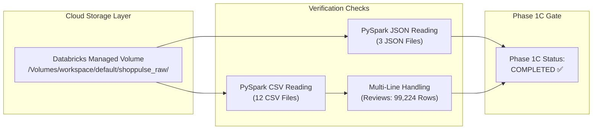

# ShopPulse: Phase 1C Databricks Cloud Storage & Volume Access Report

> **Project Title:** ShopPulse – An End-to-End E-Commerce Customer Behaviour, Sales and Delivery Intelligence Platform Using Python, Apache Spark and Databricks.  
> **Phase:** Phase 1C — Cloud Storage Setup, Raw Volume Ingestion & PySpark Access Verification  
> **Documentation Date:** 13 November 2026  
> **Status:** COMPLETED  

---

## 1. Project Overview

**ShopPulse** is a scalable Big Data Engineering and Analytics prototype engineered to process real-world e-commerce transactions, customer interactions, seller operations, and logistics performance. The platform ingests data from normalized relational tables (Olist Brazilian E-Commerce and Marketing Funnel) alongside an external REST API (Nager.Date Public Holidays). 

The data is organized into a high-performance Lakehouse following the **Medallion Architecture (Bronze $\rightarrow$ Silver $\rightarrow$ Gold)** using **Apache Spark (PySpark)** and **Delta Lake** on **Databricks**, ultimately feeding an interactive executive dashboard in **Power BI**.

Phase 1C represents the official transition from local staging to cloud object storage within Databricks.

---

## 2. Databricks Environment Details

All raw data assets have been mounted and tested inside the Databricks Lakehouse platform using Unity Catalog Managed Volumes:

| Configuration Parameter | Environment Setting | Description |
| :--- | :--- | :--- |
| **Databricks Tier** | Databricks Free Edition | Free cloud workspace environment |
| **Compute Engine** | Serverless Compute | On-demand, auto-scaling managed serverless Spark compute |
| **Unity Catalog** | `workspace` | Root governance catalog |
| **Database Schema** | `default` | Working schema namespace |
| **Volume Name** | `shoppulse_raw` | Governed Unity Catalog Managed Volume for raw assets |
| **POSIX Volume Path** | `/Volumes/workspace/default/shoppulse_raw/` | Direct file-system path accessible by PySpark readers |

---

## 3. Raw Data Upload & Cloud Accessibility

* **Total Files Uploaded:** **15 files** (11 Olist core CSV tables, 1 consolidated holidays CSV table, and 3 raw holiday JSON responses).
* **Storage Verification:** All 15 files were successfully uploaded into the Unity Catalog Volume.
* **Serverless Compute Access:** All 15 files are fully readable and queryable through Databricks Serverless PySpark compute.
* **Integrity Status:** Original source files were not intentionally modified during this verification phase.

---

## 4. Dataset Verification Table

Each uploaded dataset was inspected using PySpark to verify its schema readability and actual row counts against expected benchmarks:

| Dataset / Table Name | Expected Records | Verified PySpark Count | File Format | Cloud Path | Read Status |
| :--- | :---: | :---: | :---: | :--- | :---: |
| **Orders** (`olist_orders_dataset.csv`) | 99,441 | **99,441** | CSV | `/Volumes/workspace/default/shoppulse_raw/olist_orders_dataset.csv` | ✅ Verified |
| **Customers** (`olist_customers_dataset.csv`) | 99,441 | **99,441** | CSV | `/Volumes/workspace/default/shoppulse_raw/olist_customers_dataset.csv` | ✅ Verified |
| **Order Items** (`olist_order_items_dataset.csv`) | 112,650 | **112,650** | CSV | `/Volumes/workspace/default/shoppulse_raw/olist_order_items_dataset.csv` | ✅ Verified |
| **Products** (`olist_products_dataset.csv`) | 32,951 | **32,951** | CSV | `/Volumes/workspace/default/shoppulse_raw/olist_products_dataset.csv` | ✅ Verified |
| **Sellers** (`olist_sellers_dataset.csv`) | 3,095 | **3,095** | CSV | `/Volumes/workspace/default/shoppulse_raw/olist_sellers_dataset.csv` | ✅ Verified |
| **Payments** (`olist_order_payments_dataset.csv`) | 103,886 | **103,886** | CSV | `/Volumes/workspace/default/shoppulse_raw/olist_order_payments_dataset.csv` | ✅ Verified |
| **Reviews** (`olist_order_reviews_dataset.csv`) | 99,224 | **99,224** | CSV | `/Volumes/workspace/default/shoppulse_raw/olist_order_reviews_dataset.csv` | ✅ Verified |
| **Geolocation** (`olist_geolocation_dataset.csv`) | 1,000,163 | **1,000,163** | CSV | `/Volumes/workspace/default/shoppulse_raw/olist_geolocation_dataset.csv` | ✅ Verified |
| **Category Translation** (`product_category_name_translation.csv`) | 71 | **71** | CSV | `/Volumes/workspace/default/shoppulse_raw/product_category_name_translation.csv` | ✅ Verified |
| **Marketing Qualified Leads** (`olist_marketing_qualified_leads_dataset.csv`) | 8,000 | **8,000** | CSV | `/Volumes/workspace/default/shoppulse_raw/olist_marketing_qualified_leads_dataset.csv` | ✅ Verified |
| **Closed Deals** (`olist_closed_deals_dataset.csv`) | 842 | **842** | CSV | `/Volumes/workspace/default/shoppulse_raw/olist_closed_deals_dataset.csv` | ✅ Verified |
| **Brazil Public Holidays CSV** (`brazil_public_holidays_2016_2018.csv`) | 42 | **42** | CSV | `/Volumes/workspace/default/shoppulse_raw/brazil_public_holidays_2016_2018.csv` | ✅ Verified |
| **Holiday JSON 2016** (`brazil_holidays_2016.json`) | 14 | **14** | JSON | `/Volumes/workspace/default/shoppulse_raw/brazil_holidays_2016.json` | ✅ Verified |
| **Holiday JSON 2017** (`brazil_holidays_2017.json`) | 14 | **14** | JSON | `/Volumes/workspace/default/shoppulse_raw/brazil_holidays_2017.json` | ✅ Verified |
| **Holiday JSON 2018** (`brazil_holidays_2018.json`) | 14 | **14** | JSON | `/Volumes/workspace/default/shoppulse_raw/brazil_holidays_2018.json` | ✅ Verified |

---

## 5. Important Technical Findings & Parsing Solutions

During the initial serverless PySpark validation, critical technical nuances were identified and resolved:

### 5.1 Multi-Line CSV Parsing in Customer Reviews
* **The Challenge:**  
  When reading `olist_order_reviews_dataset.csv` using default Spark CSV parsing options (`spark.read.csv(..., header=True)`), PySpark reported incorrect record counts. Customer feedback messages (`review_comment_message`) frequently contained embedded newline characters (`\n` and `\r\n`), leading Spark to prematurely split single review records into multiple corrupted rows.
* **The Solution:**  
  Configuring explicit multi-line and escaping options resolved the parsing error completely:
  ```python
  reviews_df = (
      spark.read.format("csv")
      .option("header", "true")
      .option("inferSchema", "true")
      .option("multiLine", "true")
      .option("quote", '"')
      .option("escape", '"')
      .load("/Volumes/workspace/default/shoppulse_raw/olist_order_reviews_dataset.csv")
  )
  ```
* **Result:**  
  Record count verified accurately at exactly **99,224 rows**. In addition, `review_score` was correctly inferred as an **Integer**, and date fields (`review_creation_date`, `review_answer_timestamp`) were accurately recognized as **Timestamps**.

### 5.2 External Holiday REST API Ingestion
* The public holiday datasets extracted from the Nager.Date API were successfully validated in both JSON and CSV representations.
* Each annual JSON file (`brazil_holidays_2016.json`, `brazil_holidays_2017.json`, `brazil_holidays_2018.json`) contains 14 records, yielding **42 holiday API entries across 2016–2018**. 
* The `global`, `counties`, and `types` fields must be retained to distinguish holiday applicability (such as nationwide statutory holidays versus regional commemorations or optional bank holidays).

### 5.3 Source File Integrity
* Throughout the upload, inspection, and schema inference process, original source files were not intentionally modified during this verification phase.

---

## 6. Verification Summary



* **PySpark CSV Ingestion:** ✅ Verified (12 CSV tables read successfully with verified row counts and schemas).
* **PySpark JSON Ingestion:** ✅ Verified (3 raw API JSON payloads read and validated).
* **Databricks Volume Access:** ✅ Verified (Full POSIX read permissions via Serverless Compute).
* **Phase 1C Status:** **COMPLETED**

---

## 7. Next Phase: Medallion Architecture Implementation

With raw storage validated and accessible to Databricks Serverless compute, the project proceeds immediately to:

**Phase 2 — PySpark ETL Development using the Medallion Architecture:**
1. **Bronze Layer (`01_bronze_ingestion.py`):** Ingest raw CSV and JSON files from `/Volumes/workspace/default/shoppulse_raw/` into append-only Delta Lake tables with ingestion metadata (`_ingested_at`, `_source_file`).
2. **Silver Layer (`02_silver_transformation.py`):** Cast types, handle nulls, deduplicate records, join English translations, map sellers to closed deals, and enrich records with public holiday flags.
3. **Gold Layer (`03_gold_business_aggregates.py`):** Build curated dimensional marts and business KPIs for sales, delivery logistics, customer RFM behavior, and marketing lead conversions.

